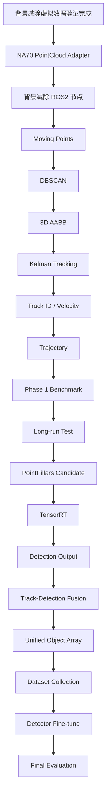

# NA70 固定俯视雷达移动目标感知系统开发文档

> 文件用途：作为 NA70 双楔镜激光雷达在 Jetson Orin Nano 4GB 上实现移动目标感知、聚类、跟踪、分类融合与可视化的统一开发基线。
> 部署平台：**Jetson Orin Nano 4GB + ROS2 Humble**。
> 当前开发原则：**先实现可靠的移动目标分割与跟踪闭环，再增加 3D 类别检测支路。**
> 运动分割方案：**体素背景减除（Background Subtraction）** — MapMOS 已在固定俯视雷达场景下验证不可用（三轮测试全判静态），详见 `D:\Code\雷达\MapMOS试验结果\试验结论.md`。
> 文档状态：工程设计基线 v3.0，可直接用于后续编码、联调与验收。

---

## 1. 项目概述

### 1.1 项目背景

本项目面向 NA70 双楔镜激光雷达的实时点云感知。雷达为**固定倒装俯视**安装（离地约 12m），现阶段已经能够通过 ROS2 发布连续 `sensor_msgs/msg/PointCloud2` 数据，后续需要在 Jetson Orin Nano 4GB 上完成：

1. 从连续点云中识别移动点（体素背景减除）；
2. 将移动点聚合为独立目标实例；
3. 估计目标 3D 空间位置、尺寸、速度和运动轨迹；
4. 在系统稳定后增加轻量级 3D Detector，对目标类别进行识别；
5. 将背景减除的运动属性与 Detector 的类别属性融合为统一对象；
6. 通过 ROS2 Topic、RViz2 和后续 GUI 提供可视化和下游接口。

### 1.2 技术路线变更记录

| 版本 | 日期 | 变更 |
|---|---|---|
| v1.0 | 初始 | MapMOS 作为运动分割主线 |
| v2.0 | 试验阶段 | MapMOS 三轮验证（原始数据 / 加墙破对称 / 固定位姿补丁）均全判静态 |
| **v3.0** | **当前** | **弃用 MapMOS，改用体素背景减除；虚拟数据已验证通过（500帧检测161,549移动点，占比1.80%）** |

**MapMOS 失败根因**：MapMOS 为车载移动雷达设计，依赖自运动位姿将历史帧对齐到地图。固定俯视雷达下：
- KISS-ICP 在旋转对称的圆形地面场景产生虚假旋转（600帧转约180°）；
- 即使强制位姿为单位矩阵，地图会累积行人走过的所有轨迹线，当前帧行人点总能在地图中找到匹配 → 全判静态。
- 这是架构层面的不匹配，非参数调优可解。

### 1.3 当前已知硬件与软件环境

| 项目 | 当前状态 |
|---|---|
| 激光雷达 | NA70 双楔镜激光雷达（固定倒装俯视，离地约12m） |
| 边缘计算平台 | Jetson Orin Nano 4GB |
| 操作系统 / JetPack | JetPack R36.4.3 |
| CUDA | CUDA 12.6 |
| ROS | ROS2 Humble |
| 运动分割方案 | 体素背景减除（已在虚拟数据验证） |
| 背景减除虚拟数据验证 | **已完成**（500帧，161,549移动点，3448个移动簇） |
| Moving Points 输出 | **待完成**（ROS2节点化） |
| 聚类 / 3D Box / Tracking | **待完成** |
| 3D Detector | 第二阶段，待选型与部署 |

> 注意：本文档不假定 NA70 的未确认硬件参数，例如线数、扫描频率、视场角、测距精度、点频、每帧点数、反射强度编码方式等。此类参数只能以 NA70 官方资料或实际 ROS2 数据为准。

---

## 2. 项目目标

### 2.1 第一阶段目标

优先建立以下完整闭环：

```text
NA70
  ↓
ROS2 PointCloud2
  ↓
体素背景减除 (Background Subtraction)
  ↓
Moving Mask
  ↓
Moving Points
  ↓
DBSCAN / Euclidean Clustering
  ↓
3D Bounding Box
  ↓
Kalman Filter + Multi-Object Tracking
  ↓
Track ID + Position + Velocity + Trajectory
```

第一阶段**不以物体类别识别为前置条件**。

只要能够稳定回答以下问题，第一阶段即具备独立价值：

- 当前有哪些移动目标？
- 每个目标在哪里？
- 每个目标的空间范围多大？
- 每个目标在向哪里运动？
- 每个目标速度是多少？
- 当前帧目标与上一帧哪个目标是同一个？
- 目标已经存在多久？
- 目标最近的运动轨迹是什么？

### 2.2 第二阶段目标

加入轻量级 3D Detector：

```text
                         ┌─ 背景减除 ─ Moving Mask / Moving Points ─┐
NA70 PointCloud2 ────────┤                                          ├─ Data Association ─ Unified Object
                         └─ 3D Detector ─ Class / 3D Box / Score ───┘
```

最终对象应包含：

```text
Object ID
Class
Moving / Static
Position
3D Bounding Box
Velocity
Trajectory
Confidence
Age / Tracking State
```

### 2.3 最终系统目标

形成一个能够被导航、避障、ADAS、机器人规划器或实验 GUI 使用的统一感知层：

```text
LiDAR → Perception → Object List → Planning / Decision / Visualization
```

---

## 3. 需求定义

## 3.1 功能需求

### FR-01 点云输入

系统必须订阅 NA70 发布的 ROS2 `PointCloud2`。

### FR-02 点云字段自适应

程序不得假定输入一定具有 Velodyne、Ouster、Hesai 等雷达的字段格式。

至少支持：

- `x`
- `y`
- `z`

可选支持：

- `intensity`
- `ring`
- `time`
- `timestamp`
- 其他 NA70 驱动自定义字段

节点启动时必须打印：

```text
PointCloud2 width
PointCloud2 height
point_step
row_step
is_dense
frame_id
fields[]
```

### FR-03 Moving Object Segmentation（背景减除）

系统必须通过**体素背景减除**对连续点云进行运动点分割，输出：

- Moving Mask
- Moving Points

背景减除核心流程：
1. 初始化阶段（前 N 帧）构建体素背景模型；
2. 对当前帧点云进行体素化；
3. 与背景模型差分，命中背景体素的点判为静态，未命中的判为移动候选；
4. 背景模型持续更新（滑动窗口 / 指数衰减）；
5. 移动候选点经 DBSCAN 聚类后输出实例。

### FR-04 移动点实例化

系统必须通过 DBSCAN 或欧式聚类将 Moving Points 分成多个独立目标。

### FR-05 3D Bounding Box

对每个聚类至少计算：

- centroid
- min/max XYZ
- axis-aligned 3D bounding box

后续可升级：

- oriented bounding box
- yaw

### FR-06 多目标跟踪

系统必须为连续帧中的同一目标分配稳定 Track ID。

### FR-07 速度估计

系统必须基于时间戳和 Track 状态估计：

- `vx`
- `vy`
- `vz`
- `speed`

### FR-08 轨迹维护

每个 Track 必须维护有限长度的历史位置序列。

### FR-09 3D Detector

第二阶段加入轻量 3D Detector，输出：

- `class_id`
- `class_name`
- `bbox_3d`
- `confidence`

### FR-10 信息融合

背景减除与 Detector 并行运行，通过 Data Association 合成统一对象。

### FR-11 可视化

RViz2 至少显示：

- 原始点云；
- Moving Points；
- Cluster；
- 3D Box；
- Track ID；
- 速度；
- 轨迹。

### FR-12 降级运行

Detector 故障时：

```text
Class = UNKNOWN
Moving/Tracking 继续工作
```

背景减除故障时：

- Detector 可以继续输出类别和 3D Box；
- 运动状态应标记为 `UNKNOWN`；
- 不允许伪造 Moving/Static 结论。

---

## 3.2 非功能需求

### NFR-01 单机部署

正式运行仅部署在：

```text
Jetson Orin Nano 4GB
```

Windows 仅可用于代码编辑、日志查看或离线辅助，不作为正式运行节点。

### NFR-02 实时性

所有性能指标必须用真实 NA70 数据测量。

文档中未经过实测的时间、FPS、内存和 GPU 利用率只能标记为：

```text
建议目标 / 待验证
```

### NFR-03 内存安全

Orin Nano 4GB 内存有限，必须防止：

- 点云历史无限缓存；
- 背景模型体素无限增长；
- Python list / NumPy 数组重复复制；
- GPU Tensor 未释放；
- Detector 和背景减除同时占满显存；
- ROS2 QoS 队列无限积压。

### NFR-04 可调试性

每个模块必须：

- 可单独启动；
- 可单独订阅/回放；
- 有明确日志；
- 有统计 Topic 或诊断输出；
- 可以关闭 Detector、Tracking 或 RViz 单独测试。

### NFR-05 可复现性

所有参数必须进入 YAML 配置，不允许散落为硬编码常量。

---

# 4. 系统总体架构

```mermaid
flowchart LR
    A[NA70 LiDAR] --> B[NA70 ROS2 Driver]
    B --> C[/na70/points_raw]

    C --> D[PointCloud Adapter]
    D --> E[背景减除 Preprocess]
    E --> F[体素背景建模 + 差分]
    F --> G[Moving Mask]
    G --> H[Moving Points]

    H --> I[Moving Point Filter]
    I --> J[DBSCAN / Euclidean Cluster]
    J --> K[3D Box Estimator]
    K --> L[Kalman + MOT]
    L --> M[Motion Tracks]

    D --> N[3D Detector]
    N --> O[Class + Detection Box + Score]

    M --> P[Data Association / Fusion]
    O --> P

    P --> Q[Unified Object Array]

    Q --> R[RViz2]
    Q --> S[GUI]
    Q --> T[Planning / Decision]
```

---

# 5. 为什么背景减除与 Detector 应并行

## 5.1 不推荐的结构

不建议：

```text
PointCloud
   ↓
背景减除
   ↓
Moving Points
   ↓
Pretrained 3D Detector
```

## 5.2 原因一：预训练 Detector 通常基于完整目标几何

PointPillars、SECOND、CenterPoint 等 3D Detector 在训练时通常使用完整 LiDAR 点云。

如果只输入 Moving Points：

- 目标静态表面点可能被删除；
- 低速目标可能只剩少量点；
- 目标轮廓不完整；
- 地面及邻近环境上下文丢失；
- 点云密度分布显著改变。

这会造成严重的输入分布变化。

## 5.3 原因二：背景减除与 Detector 解决的问题不同

背景减除：

```text
这个点是否属于运动物体？
```

Detector：

```text
这里是否存在某一类别的 3D 物体？
```

二者是互补任务，不是上下级关系。

## 5.4 原因三：静止车辆也必须可以被 Detector 看见

例如：

```text
一辆车停在红灯前
```

背景减除可能将其判为非运动区域。

但 Detector 仍应识别：

```text
Car
```

因此：

```text
Motion State != Object Class
```

必须分离。

## 5.5 原因四：慢速和启停目标

交通场景中常出现：

- 行人停下后重新移动；
- 车辆短暂停车；
- 自行车低速移动；
- 目标被遮挡后重新出现。

只用 Moving Points 驱动 Detector，容易导致类别检测闪烁。

## 5.6 推荐结构

```text
                   ┌── 背景减除 ── Motion
Full PointCloud ───┤
                   └── Detector ─ Class
                            ↓
                     Data Association
                            ↓
                     Unified Object
```

---

# 6. 数据流设计

完整数据路径：

```text
NA70 Ethernet Data
        ↓
NA70 Driver
        ↓
sensor_msgs/msg/PointCloud2
        ↓
PointCloud Adapter
        ├─→ 背景减除 Pipeline
        │      ├─ 体素化
        │      ├─ 背景模型查询
        │      ├─ 差分判定
        │      ├─ 背景模型更新
        │      └─ Moving Mask
        │
        └─→ Detector Pipeline
               ├─ detector preprocessing
               ├─ inference
               └─ detection boxes
        ↓
Moving Points
        ↓
Cluster
        ↓
Bounding Box
        ↓
Tracker
        ↓
Motion Tracks
        ↓
Association with Detector
        ↓
Unified Objects
```

---

# 7. NA70 PointCloud2 输入接口

## 7.1 建议输入 Topic

```text
/na70/points_raw
```

如果现有驱动 Topic 名不同，应通过 Launch 参数映射，不要求修改驱动。

## 7.2 消息类型

```text
sensor_msgs/msg/PointCloud2
```

## 7.3 最低必需字段

背景减除适配层最低要求：

```text
x
y
z
```

### 可选字段

若 NA70 实际提供，则可使用：

```text
intensity
ring
time
timestamp
```

但这些字段必须通过运行时检测确定。

## 7.4 禁止的硬编码

禁止直接假设：

```python
fields = ["x", "y", "z", "intensity", "ring"]
```

应动态检查：

```python
available_fields = [field.name for field in cloud.fields]
```

然后建立字段映射。

## 7.5 启动时字段诊断

建议日志：

```text
[PointCloudAdapter]
frame_id: na70_link
width: ...
height: ...
point_step: ...
fields:
  - x FLOAT32 offset=...
  - y FLOAT32 offset=...
  - z FLOAT32 offset=...
  - ...
```

未确认字段必须标记：

```text
NOT_AVAILABLE
```

---

# 8. ROS2 节点设计

建议拆分为以下节点。

| Node | 主要职责 |
|---|---|
| `na70_driver_node` | NA70 原始数据 → PointCloud2 |
| `pointcloud_adapter_node` | 字段检查、NaN 清理、ROI、格式转换 |
| `background_subtraction_node` | 体素背景建模、差分、Moving Mask |
| `moving_cluster_node` | Moving Points 聚类 |
| `bbox_estimator_node` | 3D Bounding Box |
| `multi_object_tracker_node` | Track ID、Kalman、速度和轨迹 |
| `detector_node` | 第二阶段 3D Detector |
| `object_fusion_node` | 背景减除 Track + Detector 融合 |
| `perception_visualizer_node` | Marker / Text / Trajectory |
| `perception_diagnostics_node` | 性能、掉帧、延迟、资源统计 |

第一阶段可以将：

```text
moving_cluster_node
bbox_estimator_node
multi_object_tracker_node
```

先合并为一个：

```text
moving_tracker_node
```

等算法稳定后再拆分。

---

# 9. ROS2 Topic 设计

## 9.1 输入

```text
/na70/points_raw
```

类型：

```text
sensor_msgs/msg/PointCloud2
```

## 9.2 背景减除输出

```text
/bg_subtraction/moving_points
```

类型：

```text
sensor_msgs/msg/PointCloud2
```

另可输出：

```text
/bg_subtraction/static_points
```

可选。

### Moving Mask

由于 `PointCloud2` 不天然表示与原始点一一对应的二值 Mask，可设计：

```text
/bg_subtraction/moving_mask
```

自定义消息：

```text
std_msgs/Header header
uint32 point_count
uint8[] mask
```

其中：

```text
0 = static / non-moving
1 = moving
255 = invalid / unknown
```

是否使用 255 作为 unknown 需在实现阶段固定。

## 9.3 Cluster 输出

```text
/perception/moving_clusters
```

建议自定义消息。

## 9.4 Track 输出

```text
/perception/tracks
```

## 9.5 Detector 输出

```text
/perception/detections
```

## 9.6 最终融合输出

```text
/perception/objects
```

---

# 10. 自定义 ROS2 Message

建议创建：

```text
na70_perception_msgs
```

## 10.1 BoundingBox3D.msg

```text
geometry_msgs/Point center
geometry_msgs/Vector3 size
float32 yaw
```

第一阶段如果仅 AABB：

```text
yaw = 0
```

必须在文档或消息注释中说明。

## 10.2 Detection3D.msg

```text
std_msgs/Header header

int32 detection_id
int32 class_id
string class_name

BoundingBox3D box

float32 confidence
```

## 10.3 Track3D.msg

```text
std_msgs/Header header

int32 track_id

BoundingBox3D box

geometry_msgs/Point position
geometry_msgs/Vector3 velocity

float32 speed

uint32 age
uint32 hit_count
uint32 miss_count

uint8 tracking_state
```

建议：

```text
0 = tentative
1 = confirmed
2 = lost
```

## 10.4 Object3D.msg

```text
std_msgs/Header header

int32 object_id

int32 class_id
string class_name

uint8 motion_state

BoundingBox3D box

geometry_msgs/Point position
geometry_msgs/Vector3 velocity

float32 speed

float32 motion_confidence
float32 class_confidence
float32 fusion_confidence

uint32 track_age

geometry_msgs/Point[] trajectory
```

motion_state 建议：

```text
0 = UNKNOWN
1 = STATIC
2 = MOVING
```

## 10.5 Object3DArray.msg

```text
std_msgs/Header header
Object3D[] objects
```

---

# 11. 推荐工程目录

```text
na70_perception/
├── README.md
├── docs/
│   ├── architecture.md
│   ├── interfaces.md
│   ├── deployment.md
│   └── tests.md
│
├── config/
│   ├── na70.yaml
│   ├── background_subtraction.yaml
│   ├── clustering.yaml
│   ├── tracking.yaml
│   ├── detector.yaml
│   └── fusion.yaml
│
├── launch/
│   ├── phase1_bg_subtraction_tracking.launch.py
│   ├── phase2_full_perception.launch.py
│   └── visualization.launch.py
│
├── models/
│   └── detector/
│
├── src/
│   ├── pointcloud_adapter/
│   ├── background_subtraction/
│   ├── moving_cluster/
│   ├── bbox_estimator/
│   ├── multi_object_tracker/
│   ├── detector/
│   ├── object_fusion/
│   ├── visualizer/
│   └── diagnostics/
│
├── msg/
│   ├── MovingMask.msg
│   ├── BoundingBox3D.msg
│   ├── Detection3D.msg
│   ├── Track3D.msg
│   ├── Object3D.msg
│   └── Object3DArray.msg
│
├── scripts/
│   ├── inspect_pointcloud_fields.py
│   ├── record_test_bag.sh
│   ├── benchmark_bg_subtraction.py
│   ├── benchmark_pipeline.py
│   └── resource_monitor.py
│
├── test/
│   ├── test_pointcloud_adapter.py
│   ├── test_background_subtraction.py
│   ├── test_cluster.py
│   ├── test_tracker.py
│   └── test_association.py
│
└── logs/
```

---

# 12. 模块职责

## 12.1 PointCloud Adapter

职责：

1. 检查字段；
2. 删除 NaN / Inf；
3. 可选 ROI 裁剪；
4. 将 PointCloud2 转换成背景减除所需结构；
5. 保留原始 `header.stamp`；
6. 输出统计数据。

禁止在 Adapter 中加入运动判断。

---

## 12.2 背景减除节点 (Background Subtraction)

职责：

1. 接收连续 PointCloud2；
2. 维护体素背景模型（滑动窗口 / 指数衰减）；
3. 对当前帧点云进行体素化；
4. 与背景模型差分，判定移动/静态；
5. 输出 Moving Mask；
6. 根据 Mask 恢复 Moving Points；
7. 更新背景模型。

### 核心算法

```text
当前帧点云
    ↓
体素化 (voxel_size)
    ↓
查询背景模型
    ↓
命中背景体素? ──是──→ 静态点
    │
    否
    ↓
移动候选点
    ↓
DBSCAN 聚类去噪
    ↓
Moving Points
```

### 背景模型更新策略

- **初始化阶段**：前 `bg_init_frames` 帧全部加入背景模型；
- **运行阶段**：静态点以 `learning_rate` 衰减更新背景模型；
- **背景吸收问题**：行人走回之前走过的位置时可能被背景吸收，需通过跟踪器补偿（Track 保持预测）。

### 已验证参数（虚拟数据）

| 参数 | 值 | 说明 |
|---|---|---|
| `voxel_size` | 0.15 m | 体素分辨率 |
| `bg_init_frames` | 100 | 背景初始化帧数 |
| `bg_threshold` | 3 | 体素命中次数阈值 |
| `eps` | 0.5 m | DBSCAN 邻域半径 |
| `min_samples` | 8 | DBSCAN 最小点数 |

### 虚拟数据验证结果

- 500 帧检测到 **161,549 移动点**（占比 1.80%）
- 每帧平均 323 点，中位数 289 点
- **3,448 个移动簇**
- 移动点高度范围 -0.17~2.08m（对应行人高度）
- 已知局限：行人走回前 10 秒走过的位置时会被背景吸收

---

## 12.3 Cluster

职责：

```text
Moving Points
    ↓
Noise Filter
    ↓
DBSCAN / Euclidean
    ↓
Cluster Instances
```

输出：

```text
cluster_id
point_indices
centroid
point_count
```

---

## 12.4 Bounding Box

第一阶段使用 AABB：

```text
xmin xmax
ymin ymax
zmin zmax
```

中心：

```text
cx = (xmin + xmax) / 2
cy = (ymin + ymax) / 2
cz = (zmin + zmax) / 2
```

尺寸：

```text
length = xmax - xmin
width  = ymax - ymin
height = zmax - zmin
```

第二阶段可以使用 PCA 或最小面积矩形估计 OBB/yaw。

---

## 12.5 Multi-Object Tracker

职责：

- track prediction；
- measurement association；
- state update；
- track lifecycle；
- velocity estimate；
- trajectory buffer。

**背景减除场景下跟踪器的额外职责**：当目标被背景吸收（移动点消失）时，跟踪器应进入 COAST 状态，用预测状态维持 Track，避免目标走回旧位置时 ID 丢失。

---

## 12.6 Detector

职责：

```text
Full PointCloud
    ↓
Preprocess
    ↓
3D Detector
    ↓
Class + Box + Score
```

Detector 不依赖背景减除成功。

---

## 12.7 Fusion

职责：

```text
背景减除 Track
+
Detector Box
↓
Association
↓
Unified Object
```

---

# 13. 坐标系与 TF

推荐 TF：

```text
map
└── odom
    └── base_link
        └── na70_link
```

具体是否存在 `map/odom/base_link` 取决于当前平台。

## 13.1 雷达固定在实验室

当前测试阶段：

```text
NA70 静止（倒装俯视，离地约12m）
```

可以临时使用：

```text
map == na70_link
```

即固定传感器坐标作为世界参考。

此方案适用于：

- 雷达固定；
- 平台不运动。

**背景减除在固定雷达下天然适用，无需位姿估计。**

## 13.2 雷达安装在移动平台

必须获得传感器位姿：

```text
T_map_lidar(t)
```

来源可以是：

- SLAM；
- LiDAR odometry；
- wheel odometry + IMU；
- GNSS/INS；
- 其他定位系统。

否则历史帧点云无法正确叠加，背景减除将受到自运动影响。

---

# 14. 时间同步

所有模块必须使用：

```text
PointCloud2.header.stamp
```

禁止使用处理完成时的：

```text
now()
```

替代传感器采集时间。

## 14.1 Track 的 Δt

```text
dt = stamp_current - stamp_previous
```

速度估计必须基于真实 `dt`。

## 14.2 无 TF 情况

当前测试时雷达固定：

```text
T = Identity
```

必须通过配置明确：

```yaml
sensor_is_static: true
```

而不是自动假设。

---

# 15. 背景模型与多帧组织

背景减除的核心是维护一个体素级背景模型，而非独立单帧分类。

因此 ROS2 节点需要维护有限历史。

建议数据结构：

```python
VoxelBackgroundModel:
    voxel_size: float
    voxels: dict[Tuple[int,int,int], VoxelState]
    init_frame_count: int
    max_history: int

VoxelState:
    hit_count: int
    last_seen: int  # frame index
    is_background: bool
```

## 15.1 缓存原则

不能无限累积体素。

建议配置：

```yaml
background_model:
  voxel_size: 0.15
  init_frames: 100
  max_voxels: <待验证>
  decay_rate: <待验证>
```

具体数值应根据：

- NA70 实际帧率；
- 每帧点数；
- 视场范围；
- Orin 4GB 内存；

通过实测确定。

## 15.2 背景模型更新

静态点命中的体素：

```text
hit_count += 1
last_seen = current_frame
```

长期未命中的体素：

```text
hit_count *= decay_rate
if hit_count < threshold: remove
```

---

# 16. 背景减除预处理与推理

## 16.1 处理流程

```text
PointCloud2
   ↓
read XYZ
   ↓
remove invalid points
   ↓
coordinate transform (固定雷达无需)
   ↓
voxelization
   ↓
query background model
   ↓
difference / threshold
   ↓
moving candidate mask
   ↓
DBSCAN denoise
   ↓
restore point-level mask
   ↓
update background model
```

## 16.2 参数

全部写入 YAML：

```yaml
background_subtraction:
  voxel_size: 0.15
  init_frames: 100
  bg_threshold: 3
  learning_rate: 0.01
  max_range: <待验证>
  min_range: <待验证>
  use_gpu: false  # 第一阶段CPU实现，后续可CUDA优化
```

**禁止为了"看起来合理"而编造参数。**

实际实施时：

1. 使用虚拟数据验证的参数作为初始值；
2. 用真实 NA70 静态场景校准背景模型；
3. 用真实 NA70 移动场景调优阈值；
4. 对 NA70 做独立参数评估。

---

# 17. Moving Mask 后处理

原始背景减除 Mask 不建议直接作为最终目标输入。

建议后处理：

```text
Raw Moving Mask
     ↓
ROI
     ↓
Isolated Point Removal (DBSCAN)
     ↓
Ground / Noise Optional Filter
     ↓
Moving Points
```

## 17.1 ROI

例如配置形式：

```yaml
roi:
  x_min: <待验证>
  x_max: <待验证>
  y_min: <待验证>
  y_max: <待验证>
  z_min: <待验证>
  z_max: <待验证>
```

所有数值由真实安装位置决定。

## 17.2 小区域噪声

可删除：

```text
point_count < min_cluster_points
```

但阈值必须通过小目标测试确定，避免删掉远距离行人。

---

# 18. DBSCAN 与欧式聚类

## 18.1 第一阶段推荐 DBSCAN

优点：

- 不需要预先指定目标数量；
- 可以标记噪点；
- 实现简单；
- 对 Moving Points 很适合做第一版实例化。

输入：

```text
N × 3
[x, y, z]
```

输出：

```text
cluster label
```

## 18.2 主要参数

```yaml
clustering:
  method: dbscan
  eps: 0.5
  min_samples: 8
  min_cluster_points: <待验证>
  max_cluster_points: <待验证>
```

## 18.3 参数风险

固定 `eps` 在不同距离可能存在问题：

```text
近距离点密
远距离点稀
```

后续可升级为：

- range-adaptive DBSCAN；
- voxel connected components；
- Euclidean Cluster with range-adaptive tolerance。

## 18.4 欧式聚类

如果转换为 PCL/C++：

```text
pcl::EuclideanClusterExtraction
```

通常更适合 ROS2 C++ 实时链路。

推荐路线：

```text
Phase 1A：Python DBSCAN 快速验证
Phase 1B：必要时 C++ / PCL 优化
```

---

# 19. 3D Bounding Box

## 19.1 AABB

第一阶段使用 Axis-Aligned Bounding Box。

优点：

- 计算快；
- 稳定；
- 无 yaw 抖动；
- 非常适合 Tracking 初版。

缺点：

- 旋转目标尺寸偏大。

## 19.2 OBB

后续可使用：

```text
XY PCA
   ↓
principal direction
   ↓
yaw
   ↓
oriented rectangle
```

需要解决：

```text
yaw ≈ yaw + π
```

的方向二义性以及稀疏点导致的抖动。

---

# 20. Kalman Filter

## 20.1 推荐状态

第一阶段采用恒速度 CV 模型：

```text
x = [
    px,
    py,
    pz,
    vx,
    vy,
    vz
]^T
```

状态转移：

```text
px(k+1) = px(k) + vx(k)·dt
py(k+1) = py(k) + vy(k)·dt
pz(k+1) = pz(k) + vz(k)·dt
```

矩阵：

```text
F =
[1 0 0 dt 0  0 ]
[0 1 0 0  dt 0 ]
[0 0 1 0  0  dt]
[0 0 0 1  0  0 ]
[0 0 0 0  1  0 ]
[0 0 0 0  0  1 ]
```

观测：

```text
z = [px py pz]^T
```

## 20.2 为什么先用 CV

当前系统目标是：

```text
稳定目标 ID + 速度
```

而不是一开始建立复杂运动学模型。

CV 足以作为：

- 基线；
- 验证框架；
- 后续 IMM / CTRV 的对照。

---

# 21. 多目标跟踪

每帧：

```text
1. Predict
2. Build cost matrix
3. Gating
4. Assignment
5. Kalman Update
6. Create new tracks
7. Mark missed tracks
8. Delete expired tracks
```

## 21.1 Association Cost

第一版可以用：

```text
3D centroid distance
```

或：

```text
XY centroid distance
```

后续增加：

```text
3D IoU
velocity consistency
box size similarity
```

综合：

```text
C =
w_d * normalized_distance
+ w_iou * (1 - IoU)
+ w_v * velocity_difference
```

## 21.2 Assignment

推荐：

```text
Hungarian Algorithm
```

## 21.3 Track 生命周期

建议状态：

```text
TENTATIVE
CONFIRMED
LOST
DELETED
```

配置：

```yaml
tracking:
  min_hits: <待验证>
  max_misses: <待验证>
  association_distance: <待验证>
  trajectory_length: <待验证>
  coast_frames: <待验证>  # 背景吸收时维持预测的帧数
```

## 21.4 ID 稳定性

必须测试：

- 两人交叉；
- 目标近距离并行；
- 临时遮挡；
- 目标停下（背景吸收）；
- 再次运动。

---

# 22. 速度估计

不推荐只使用：

```text
(current_position - previous_position) / dt
```

因为 Moving Points 和聚类 centroid 有抖动。

优先使用 Kalman 状态：

```text
vx
vy
vz
```

速度：

```text
speed = sqrt(vx² + vy² + vz²)
```

如果只关心水平运动：

```text
speed_xy = sqrt(vx² + vy²)
```

必须明确所使用的坐标系。

---

# 23. 轨迹

每个 Track 保存：

```text
deque<geometry_msgs::Point>
```

限制：

```text
max_trajectory_length
```

RViz 可用：

```text
visualization_msgs/msg/Marker
LINE_STRIP
```

显示历史轨迹。

---

# 24. 3D Detector 候选方案

第二阶段应优先考虑轻量、成熟、可转 TensorRT 的 LiDAR Detector。

## 24.1 PointPillars

推荐优先级：

```text
★★★★★
```

原因：

- 结构相对轻量；
- 工程成熟；
- KITTI 等公开数据集上有大量预训练权重；
- TensorRT 部署资料多；
- NVIDIA 有 CUDA-PointPillars Jetson 示例。

风险：

- 公开权重的数据分布与 NA70 不一致；
- KITTI 三类模型通常仅覆盖：
  - Car
  - Pedestrian
  - Cyclist
- 不能因此宣称可直接可靠识别 NA70 场景。

## 24.2 SECOND

优点：

- 经典 voxel detector；
- OpenPCDet / MMDetection3D 支持成熟。

缺点：

- 相比 PointPillars 一般计算更重。

推荐：

```text
作为准确率/性能对照
```

## 24.3 CenterPoint

优点：

- 检测与中心估计框架成熟；
- 多数据集使用广泛。

缺点：

- 模型和部署链路通常比第一阶段需要的更复杂；
- Orin Nano 4GB 必须实测资源。

推荐：

```text
第二候选
```

## 24.4 选择标准

选型不能只看论文精度，应使用：

| 指标 | 重要性 |
|---|---|
| Orin Nano 4GB 能否运行 | 极高 |
| 峰值 GPU 内存 | 极高 |
| TensorRT 可部署性 | 极高 |
| 推理延迟 | 高 |
| 点云格式可适配性 | 高 |
| 自定义数据训练难度 | 高 |
| 目标类别覆盖 | 高 |
| 公开权重 | 中 |
| 原论文 SOTA | 低于工程可运行性 |

---

# 25. Detector 输入为什么使用完整点云

Detector 输入：

```text
Full PointCloud
```

不是：

```text
Moving Points
```

其原因包括：

1. 保留完整目标几何；
2. 保留地面与环境上下文；
3. 识别静止物体；
4. 与公开训练数据分布更接近；
5. 允许背景减除和 Detector 相互独立故障；
6. 便于后续分别微调。

---

# 26. Orin Nano 4GB 资源约束

4GB 是本项目最重要的工程约束之一。

同时运行：

```text
ROS2
背景减除 (CPU/GPU)
NumPy / SciPy
Detector (第二阶段)
PyTorch / CUDA (第二阶段)
RViz2
```

可能出现：

```text
RAM 不足
CUDA OOM
swap 抖动
帧率下降
系统被 OOM killer 杀死
```

因此必须建立资源预算。

## 26.1 第一阶段

只运行：

```text
NA70 Driver
背景减除
Cluster
Tracker
```

先测：

```text
RAM
GPU memory (如使用GPU)
GPU utilization
CPU utilization
temperature
power
latency
```

## 26.2 第二阶段

再加入 Detector。

## 26.3 建议资源监控

使用：

```text
tegrastats
```

并定时记录：

```text
RAM
SWAP
GR3D
CPU
temperature
power
```

---

# 27. 性能优化路线

优化顺序建议：

```text
正确性
↓
内存稳定
↓
减少不必要复制
↓
ROI / Downsample
↓
背景模型体素上限
↓
GPU 加速背景减除 (可选)
↓
TensorRT Detector
↓
C++ 后处理
↓
Pipeline 并行
```

不要在算法尚未正确之前直接做 TensorRT。

## 27.1 减少数据复制

避免：

```text
PointCloud2
→ Python list
→ NumPy copy
→ NumPy copy
→ NumPy copy
```

应尽量：

- contiguous NumPy；
- 避免重复构造大型数组；
- 体素化使用向量化操作。

## 27.2 GPU 加速背景减除

背景减除的体素化和差分可以用 CUDA 加速，但第一阶段先用 CPU 实现验证正确性。

建议实验：

```text
CPU baseline
vs
CUDA voxelization
```

比较：

- 输出一致性；
- latency；
- memory；
- 实现复杂度。

## 27.3 TensorRT

优先将第二阶段 Detector TensorRT 化。

原因：

- PointPillars 已存在成熟 CUDA/TensorRT 工程参考；
- 背景减除逻辑简单，CPU 即可满足实时性。

因此：

```text
背景减除：先 NumPy / SciPy (CPU)
Detector：优先 TensorRT
```

---

# 28. 背景减除 + Detector 数据关联

输入：

```text
Tracks = {T1, T2, ...}
Detections = {D1, D2, ...}
```

## 28.1 Association 指标

第一版推荐：

```text
BEV IoU
+
Center Distance
```

例如：

```text
valid if:
    distance < d_gate
    AND/OR
    IoU > iou_gate
```

阈值全部待验证。

## 28.2 Cost

```text
cost(i,j)
=
w1 * normalized_center_distance
+
w2 * (1 - BEV_IoU)
```

后续：

```text
+ w3 * size_difference
+ w4 * class_history_penalty
```

## 28.3 Hungarian

建立：

```text
Track × Detection Cost Matrix
```

使用 Hungarian 求最优匹配。

## 28.4 融合规则

匹配成功：

```text
Object ID        ← Track ID
Position         ← Tracker
Velocity         ← Tracker
Trajectory       ← Tracker
Moving State     ← 背景减除 / Track
Class            ← Detector
Class Confidence ← Detector
Box              ← 可选择 Detector Box 或融合 Box
```

未匹配 Detector 的 Track：

```text
Class = UNKNOWN
Motion = MOVING
```

未匹配 Track 的 Detection：

```text
Class = Detector Class
Motion = UNKNOWN 或 STATIC候选
```

不得仅因为"没有背景减除 Track"就直接判定 STATIC。

---

# 29. 类别稳定策略

Detector 每帧结果可能闪烁：

```text
Car
Car
Cyclist
Car
```

可对 Track 维护类别历史：

```text
class_score_accumulator
```

例如指数滑动：

```text
P_t = α P_detector + (1-α) P_(t-1)
```

最终输出：

```text
argmax(P_t)
```

具体 α 待验证。

---

# 30. 最终对象数据结构

内部 C++/Python 逻辑结构可以设计为：

```text
TrackedObject
{
    id

    class_id
    class_name

    motion_state

    position
    velocity
    speed

    bbox_center
    bbox_size
    yaw

    motion_confidence
    class_confidence
    fusion_confidence

    age
    hits
    misses

    timestamp

    trajectory[]
}
```

---

# 31. RViz2 可视化

建议 Topic：

```text
/visualization/moving_points
/visualization/boxes
/visualization/tracks
/visualization/labels
/visualization/trajectories
```

## 31.1 点云

Moving Points：

```text
PointCloud2
```

## 31.2 Bounding Box

使用：

```text
Marker.CUBE
```

## 31.3 ID / Class / Speed

使用：

```text
Marker.TEXT_VIEW_FACING
```

显示：

```text
ID: 7
Class: Pedestrian
State: MOVING
Speed: 1.24 m/s
Conf: 0.86
```

其中数值仅为显示格式示例，不代表当前实测。

## 31.4 Trajectory

使用：

```text
Marker.LINE_STRIP
```

---

# 32. GUI 设计建议

第一版不需要立即开发独立 GUI。

优先：

```text
RViz2 + ROS2 Topic
```

系统稳定后 GUI 可包含：

### 左侧

```text
3D PointCloud
Moving Points
3D Boxes
Trajectories
```

### 右侧

```text
Object Count
Moving Count
Track Table
FPS
Latency
GPU
RAM
Temperature
```

对象表：

| ID | Class | State | X | Y | Speed | Confidence |
|---:|---|---|---:|---:|---:|---:|

---

# 33. 日志设计

统一使用 ROS2 logging：

```text
RCLCPP_INFO
RCLCPP_WARN
RCLCPP_ERROR
```

Python：

```text
self.get_logger().info(...)
```

禁止每帧大量打印点坐标。

## 33.1 周期统计

建议每 1~5 s 输出：

```text
input_fps
bg_subtraction_fps
moving_point_count
cluster_count
track_count
detector_fps
pipeline_latency
dropped_frames
```

频率具体由实际日志量决定。

---

# 34. 配置文件

## 34.1 background_subtraction.yaml

```yaml
background_subtraction:
  voxel_size: 0.15
  init_frames: 100
  bg_threshold: 3
  learning_rate: 0.01
  max_range: null
  min_range: null
  use_gpu: false

roi:
  x_min: null
  x_max: null
  y_min: null
  y_max: null
  z_min: null
  z_max: null
```

## 34.2 clustering.yaml

```yaml
clustering:
  method: dbscan

  eps: 0.5
  min_samples: 8

  min_cluster_points: null
  max_cluster_points: null
```

## 34.3 tracking.yaml

```yaml
tracking:
  model: constant_velocity

  min_hits: null
  max_misses: null
  coast_frames: null

  max_association_distance: null

  trajectory_length: null
```

## 34.4 detector.yaml

```yaml
detector:
  enabled: false

  backend: tensorrt
  model_type: pointpillars

  model_path: null

  confidence_threshold: null
  nms_threshold: null
```

## 34.5 fusion.yaml

```yaml
fusion:
  center_distance_gate: null
  bev_iou_gate: null

  distance_weight: null
  iou_weight: null
```

---

# 35. Launch 设计

## 35.1 Phase 1

```text
phase1_bg_subtraction_tracking.launch.py
```

启动：

```text
NA70 Driver
PointCloud Adapter
背景减除
Moving Cluster
Tracker
Visualizer
Diagnostics
```

## 35.2 Phase 2

```text
phase2_full_perception.launch.py
```

额外启动：

```text
Detector
Fusion
```

---

# 36. 开发流程

## Phase 0：运行环境

### 已完成

- [x] Jetson Orin Nano 4GB 环境确定
- [x] JetPack R36.4.3
- [x] CUDA 12.6
- [x] ROS2 Humble 平台确定
- [x] 虚拟 PCAP 数据生成（600帧，4个行人轨迹）
- [x] 背景减除算法在虚拟数据上验证通过
- [x] MapMOS 方案验证并弃用（三轮测试全判静态）

### 待确认

- [ ] 背景减除在真实 NA70 数据上的效果
- [ ] 峰值 CPU / RAM 占用
- [ ] 背景模型初始化时间

---

## Phase 1：NA70 → 背景减除

### 目标

```text
/na70/points_raw
→
背景减除
→
/bg_subtraction/moving_points
```

### 任务

- [ ] 检查 NA70 `PointCloud2.fields`
- [ ] 保存一段 rosbag
- [ ] 离线重复回放
- [ ] 完成 PointCloud Adapter
- [ ] 接入背景减除节点
- [ ] 背景模型初始化
- [ ] Moving Mask 输出
- [ ] Moving Points 输出
- [ ] RViz 显示 Moving Points
- [ ] 静态场景测试（误检率）
- [ ] 单人移动测试
- [ ] 多目标测试
- [ ] 资源统计

### Phase 1 验收

至少应可以：

```text
ros2 topic echo /bg_subtraction/...
RViz 看到 Moving Points
```

并证明系统连续运行没有 OOM。

---

## Phase 2：Moving Points → Cluster

任务：

- [ ] DBSCAN
- [ ] 去孤立噪声
- [ ] Cluster centroid
- [ ] Cluster point count
- [ ] Cluster 可视化

验收：

```text
两个人在雷达前移动
→
大多数有效时段能够形成两个独立 cluster
```

具体成功率必须实测后填写。

---

## Phase 3：3D Box

任务：

- [ ] AABB
- [ ] Marker.CUBE
- [ ] box size filter

后续：

- [ ] PCA OBB
- [ ] yaw

---

## Phase 4：Tracking

任务：

- [ ] Kalman Filter
- [ ] Hungarian
- [ ] Track lifecycle
- [ ] COAST 状态（背景吸收补偿）
- [ ] Velocity
- [ ] Trajectory
- [ ] ID visualization

验收：

```text
同一目标连续移动
→
Track ID 应在无严重遮挡条件下保持稳定
```

量化阈值在测试后确定。

---

## Phase 5：第一阶段系统验收

达到：

```text
NA70
→ PointCloud
→ 背景减除
→ Moving Points
→ Cluster
→ Box
→ Track
→ Speed
→ Trajectory
```

此阶段暂时：

```text
Class = UNKNOWN
```

这是可接受状态。

---

## Phase 6：Detector

推荐先测试：

```text
PointPillars
```

任务：

- [ ] 在 PC/开发环境验证模型输出逻辑（仅作为辅助时可）
- [ ] 确认 Jetson 环境可构建
- [ ] TensorRT / CUDA runtime
- [ ] NA70 PointCloud Adapter
- [ ] 输出 Detection3D
- [ ] 性能测试

正式部署仍只在 Jetson Orin Nano。

---

## Phase 7：Fusion

任务：

- [ ] Track-Detection cost matrix
- [ ] gating
- [ ] Hungarian
- [ ] class temporal smoothing
- [ ] Object3DArray

最终：

```text
/perception/objects
```

---

# 37. 测试场景

至少设计以下场景。

## T01 静态空场景

环境：

```text
墙
桌椅
静止设备
```

目标：

- Moving false positive 尽可能低；
- 观察双楔镜扫描模式是否造成周期性伪运动；
- 背景模型收敛时间。

---

## T02 单人横向行走

目标：

- Moving Points 连续；
- cluster 稳定；
- Track ID 稳定；
- 速度方向合理。

---

## T03 单人径向接近

目标：

- 距离变化正确；
- 速度符号与坐标定义一致。

---

## T04 单人停止

过程：

```text
移动
↓
停止（背景吸收）
↓
再次移动
```

用于验证：

- 背景减除 motion state 变化；
- Track COAST 是否保留 ID；
- Detector 后续能否继续识别人。

---

## T05 两人同向

验证：

- 是否误合并 cluster。

---

## T06 两人交叉

验证：

- ID switch；
- Hungarian + Kalman 稳定性。

---

## T07 遮挡

验证：

- Track miss；
- reacquire；
- ID continuity。

---

## T08 小目标 / 远距离

主要用于调：

```text
min_cluster_points
DBSCAN eps
```

---

## T09 静止车辆 / 运动人

第二阶段验证：

```text
Detector = Car
背景减除 = Static
```

同时：

```text
Pedestrian = Moving
```

证明类别与运动属性解耦。

---

## T10 长时间运行

建议至少建立：

```text
30 min
1 h
```

等长测工况。

具体最终验收时长可根据项目要求确定。

测试：

- memory leak；
- 背景模型体素增长；
- Track ID 累积；
- ROS queue；
- 温度；
- 降频。

---

# 38. 评价指标

## 38.1 背景减除

如果有人工标注：

```text
Precision
Recall
F1
IoU
```

Moving class：

```text
TP
FP
FN
```

无标注时可用虚拟数据的真值轨迹评估。

## 38.2 Cluster

```text
cluster recall
over-segmentation
under-segmentation
```

## 38.3 Tracking

推荐：

```text
ID Switch
Track Fragmentation
Track Recall
Position RMSE
Velocity RMSE
```

如果建立标准 MOT 标签，后续可加入：

```text
MOTA
MOTP
HOTA
```

## 38.4 Detector

```text
Precision
Recall
mAP
per-class AP
```

但只有完成 NA70 数据标注后，才能评价 NA70 上的实际 detector 精度。

## 38.5 系统性能

必须测量：

```text
input FPS
背景减除 latency
cluster latency
tracker latency
detector latency
fusion latency
end-to-end latency

RAM peak
GPU memory peak
CPU utilization
GPU utilization
temperature
power
```

---

# 39. 性能目标

以下均为**建议目标 / 待验证**，不是当前实测。

## 39.1 稳定性

建议：

```text
连续运行 ≥ 30 min 无 crash
```

后续提高到：

```text
≥ 1 h
```

## 39.2 实时性

不能先写死为 10 Hz、20 Hz 或 30 Hz。

应先测：

```text
NA70 实际输入率 = F_sensor
```

系统最低目标建议定义为：

```text
处理吞吐量尽量接近 F_sensor
```

如无法达到，则明确采用：

```text
latest-frame policy
```

而不是积压。

## 39.3 延迟

建议目标：

```text
End-to-end latency < 一个可接受的传感器更新周期或若干更新周期
```

具体毫秒阈值：

```text
待 NA70 实际频率和下游控制需求确定
```

---

# 40. QoS 与掉帧策略

实时感知通常不应堆积旧帧。

建议：

```text
BEST_EFFORT
KEEP_LAST
depth = 1~若干
```

具体取决于驱动兼容性。

如果计算跟不上：

```text
处理最新帧
丢弃过时帧
```

而不是：

```text
10 秒后处理 10 秒前的点云
```

必须记录：

```text
received_frames
processed_frames
dropped_frames
```

---

# 41. 异常与故障策略

## 41.1 点云为空

行为：

```text
WARN
skip frame
不更新 tracker measurement
```

---

## 41.2 TF 缺失

移动平台模式：

```text
禁止错误叠帧
```

应：

```text
skip 背景减除更新
或进入 degraded mode
```

固定雷达模式可通过配置使用 Identity。

---

## 41.3 CUDA OOM（第二阶段 Detector）

处理：

1. 捕获异常；
2. 记录内存统计；
3. 清理当前输入；
4. 停止 Detector；
5. 尝试保持主背景减除/Tracking 链路；
6. 若背景减除也无法继续，则输出诊断错误。

---

## 41.4 Detector 崩溃

降级：

```text
Track:
  id = valid
  motion = valid
  class = UNKNOWN
```

---

## 41.5 背景减除无输出

Detector 继续：

```text
class = valid
motion = UNKNOWN
```

不应：

```text
motion = STATIC
```

---

## 41.6 Cluster 短时消失（背景吸收）

Tracker 进入：

```text
LOST / COAST
```

使用预测状态短时间维持 Track。

超过：

```text
max_misses
```

删除。

---

# 42. 诊断状态

建议发布：

```text
/perception/diagnostics
```

可使用：

```text
diagnostic_msgs/msg/DiagnosticArray
```

状态：

```text
NA70_INPUT
TF
BG_SUBTRACTION
CLUSTER
TRACKER
DETECTOR
FUSION
RESOURCE
```

---

# 43. 模型训练与微调路线

公开 Detector 权重可以作为迁移起点，但不能假定在 NA70 数据上已经可靠。

背景减除**不需要训练**，参数通过场景校准确定。

推荐路线：

```text
Stage A
背景减除虚拟数据验证（已完成）

Stage B
NA70 无标注数据定性测试

Stage C
采集 NA70 数据

Stage D
标 3D Boxes + Classes

Stage E
微调 Detector

Stage F
联合系统评估
```

---

# 44. Detector 数据标注

每帧：

```text
3D Bounding Box
Class
Track ID（推荐）
```

类别体系不要一开始过大。

例如第一版可以：

```text
Pedestrian
Vehicle
Cyclist
Other
```

是否使用 KITTI：

```text
Car / Pedestrian / Cyclist
```

应取决于项目真实应用。

---

# 45. 数据集目录建议

```text
dataset/
├── sequences/
│   ├── 0001/
│   │   ├── points/
│   │   ├── timestamps.txt
│   │   └── boxes/
│   └── ...
│
├── splits/
│   ├── train.txt
│   ├── val.txt
│   └── test.txt
│
└── metadata/
```

必须按 sequence 划分 train/val/test。

禁止把同一连续序列相邻帧随机分散到训练集和测试集，否则会产生严重数据泄漏。

---

# 46. 风险清单

| 风险 | 等级 | 说明 | 应对 |
|---|---|---|---|
| 背景吸收（目标走回旧位置） | 高 | 背景减除固有问题，目标重新进入已建模区域会被判静态 | Track COAST + 预测维持 + 背景模型衰减 |
| 双楔镜扫描时序导致运动畸变 | 高 | 单帧不同点并非同一时刻 | 优先检查 point-level time；必要时 deskew |
| 4GB 内存不足 | 高 | 背景模型 + Detector 并行压力大 | 限体素上限、分阶段、TensorRT |
| 公开 Detector 权重域不匹配 | 高 | NA70 密度/视角不同 | 自定义数据微调 |
| DBSCAN 远近距离参数不统一 | 中 | 远目标容易碎裂 | adaptive eps |
| Track ID switch | 中 | 交叉/遮挡/背景吸收 | Kalman + IoU + COAST |
| Moving Points 太少 | 中 | box 不稳定 | temporal tracking |
| 静止目标无法由背景减除提供实例 | 正常设计 | 背景减除任务本就不是通用检测 | Detector 并行 |
| TensorRT 环境版本兼容 | 中 | JetPack/TensorRT/CUDA 绑定 | 使用 JetPack 自带 TensorRT 版本 |
| 背景模型初始化期间漏检 | 低 | 前 N 帧无移动检测输出 | 初始化完成后再开启输出 |

---

# 47. 双楔镜雷达专项风险

NA70 为双楔镜扫描雷达，实际点云可能表现出明显的扫描时间结构。

因此必须检查：

```text
一帧点云是否代表同一瞬间？
```

若单帧扫描历时不可忽略，而点又来自连续扫描轨迹：

```text
moving object
+
sensor motion (固定雷达无此问题)
```

都会造成空间畸变。

如果 PointCloud2 提供：

```text
time / timestamp
```

则应保留，并为后续 deskew 留接口。

如果没有逐点时间：

```text
不得假定能够进行严格点级去畸变
```

只能依据驱动或厂商协议进一步确认。

---

# 48. 已完成 / 进行中 / 待完成总表

## 已完成

- [x] Jetson Orin Nano 4GB 硬件平台确定
- [x] ROS2 Humble 平台确定
- [x] JetPack R36.4.3
- [x] CUDA 12.6
- [x] 虚拟 PCAP 数据生成（600帧，4个行人轨迹）
- [x] MapMOS 方案验证并弃用（三轮测试全判静态）
- [x] 背景减除算法在虚拟数据上验证通过（161,549移动点，3448簇）
- [x] 系统总体方案确定（背景减除 + Detector 并行）
- [x] 确定第一阶段先完成 Moving Points + Cluster + Track

## 进行中

- [ ] 背景减除 ROS2 节点化
- [ ] NA70 PointCloud2 字段确认
- [ ] 真实 NA70 数据背景减除验证

## 待完成

- [ ] Moving Points ROS2 输出
- [ ] DBSCAN / Euclidean Clustering
- [ ] 3D Box
- [ ] Kalman Filter
- [ ] Hungarian Association
- [ ] Track ID
- [ ] Velocity
- [ ] Trajectory
- [ ] RViz 完整显示
- [ ] 长时间运行测试
- [ ] Detector 选型
- [ ] PointPillars Jetson 验证
- [ ] TensorRT
- [ ] Detector 与背景减除融合
- [ ] Object3DArray
- [ ] GUI
- [ ] NA70 数据标注
- [ ] Detector 微调
- [ ] 全系统量化评估

---

# 49. 第一阶段最小可用系统 MVP

第一阶段不要同时开发过多功能。

MVP 定义：

```text
NA70
↓
PointCloud2
↓
背景减除
↓
Moving Points
↓
DBSCAN
↓
AABB
↓
Kalman + Hungarian
↓
ID + Position + Velocity
↓
RViz
```

输出：

```text
ID 1
State MOVING
Position (...)
Velocity (...)
Box (...)
```

此时：

```text
Class UNKNOWN
```

完全合理。

---

# 50. 第二阶段 MVP

```text
Full PointCloud
↓
PointPillars / 其他轻量 Detector
↓
Class + Box
```

并行：

```text
背景减除 → Motion Track
```

融合后：

```text
ID 1
Class Pedestrian
State MOVING
Position
Velocity
Trajectory
Confidence
```

---

# 51. 验收标准

## 51.1 Phase 1 验收

必须全部满足：

- [ ] NA70 PointCloud2 可连续输入；
- [ ] 背景减除连续运行；
- [ ] Moving Points 在 RViz 可见；
- [ ] 无目标静态场景能够完成基线误检统计；
- [ ] 单个移动人目标可形成 cluster；
- [ ] cluster 可生成 3D Box；
- [ ] 同一目标可形成 Track ID；
- [ ] 可输出速度；
- [ ] 可显示轨迹；
- [ ] 连续运行长测无 crash / OOM；
- [ ] 输出 CPU/RAM/latency 统计。

其中所有"准确率""FPS""延迟"等定量阈值在首次实测后冻结。

## 51.2 Phase 2 验收

- [ ] Detector 在 Orin Nano 4GB 上可稳定运行；
- [ ] 能输出至少项目所需类别；
- [ ] Detector 与背景减除不相互阻塞；
- [ ] 同一实体可正确关联；
- [ ] Detector 挂掉后 Tracking 继续；
- [ ] 背景减除无结果时 Detector 仍可输出对象；
- [ ] `/perception/objects` 输出结构稳定。

---

# 52. 建议 benchmark 记录格式

CSV：

```text
timestamp,
input_points,
moving_points,
cluster_count,
track_count,
det_count,
bg_subtraction_ms,
cluster_ms,
tracker_ms,
detector_ms,
fusion_ms,
pipeline_ms,
ram_mb,
swap_mb,
gpu_util,
gpu_mem_mb,
cpu_util,
temperature
```

每次实验记录：

```text
git commit
config hash
scene id
rosbag name
```

---

# 53. rosbag 测试策略

实时算法开发不应该每次都依赖现场雷达。

建议录制：

```bash
ros2 bag record /na70/points_raw /tf /tf_static
```

如果还有定位：

```text
/odom
/imu
```

一并录制。

建立固定回归 bag：

```text
bag_static
bag_one_person
bag_two_person
bag_crossing
bag_stop_go
bag_occlusion
```

之后每次修改算法都使用同一组 bag 回放。

---

# 54. 推荐研发顺序

严格按照：

```text
1. PointCloud 字段确认
2. 背景减除 ROS2 节点化
3. NA70 单帧适配
4. NA70 连续帧 / 背景模型初始化
5. Moving Mask
6. Moving Points
7. RViz
8. DBSCAN
9. AABB
10. Kalman
11. Hungarian
12. Track ID
13. Velocity
14. Trajectory
15. Benchmark
16. Long-run test
17. Detector
18. TensorRT
19. Fusion
20. Dataset / Fine-tuning
```

不要跳到第 17 步后再回来调第 4 步。

---

# 55. 当前下一步任务

当前最合理的下一步不是立即部署 Detector。

应完成：

## Step 1

确认 NA70 PointCloud2：

```bash
ros2 topic list
ros2 topic info /na70/points_raw
ros2 topic echo /na70/points_raw --once
```

并编写：

```text
inspect_pointcloud_fields.py
```

打印真实 fields。

## Step 2

将已验证的背景减除脚本（`fixed_radar_mos.py`）封装为 ROS2 节点：

- 订阅 `/na70/points_raw`
- 维护体素背景模型
- 发布 `/bg_subtraction/moving_points`
- 参数从 YAML 读取

## Step 3

实现：

```text
PointCloud2 → NumPy → 背景减除 → Moving Points
```

## Step 4

固定雷达情况下使用：

```text
T_world_lidar = Identity
```

验证 NA70 连续数据。

## Step 5

输出：

```text
/bg_subtraction/moving_points
```

并用 RViz 验证。

完成这一步以后，才进入 DBSCAN。

---

# 56. 后续路线图



---

# 57. 技术决策摘要

## 已确定

### 决策 1

```text
正式运行：Jetson Orin Nano
```

不依赖 Windows。

### 决策 2

```text
背景减除 = 运动分割
Detector = 类别检测
```

二者并行。

### 决策 3

第一阶段：

```text
背景减除
→ Moving Points
→ Cluster
→ Box
→ Tracking
```

不等待 Detector。

### 决策 4

第一版：

```text
体素背景减除 + DBSCAN + AABB + CV Kalman + Hungarian
```

保持简单、可解释、可调试。

### 决策 5

Detector：

```text
PointPillars 优先候选
```

但是否最终采用必须经过 Orin Nano 4GB 实测。

### 决策 6

弃用 MapMOS：

```text
MapMOS 在固定俯视雷达下架构不匹配
三轮验证全判静态
不再作为运动分割方案
```

### 决策 7

对任何 NA70 未确认字段和参数：

```text
先测量
再编码
```

不套用其他品牌雷达参数。

---

# 58. 外部实现依据

本设计参考了以下公开项目/论文的能力边界，但不会把其公开数据集结果直接当成 NA70 实测结果：

1. **背景减除（Background Subtraction）**
   固定雷达场景下经典的运动检测方法，通过维护背景模型与当前帧差分识别移动点。无需训练、计算量小、适合边缘部署。本项目已在虚拟数据上验证通过。

2. **NVIDIA-AI-IOT / CUDA-PointPillars**
   提供面向 NVIDIA Jetson / CUDA / TensorRT 的 PointPillars 工程实现，可作为第二阶段轻量 3D Detector 的重要部署参考。其公开性能数字基于其指定平台和 KITTI 数据，**不能外推为本项目 Orin Nano 4GB + NA70 的实测性能**。

3. **OpenPCDet / MMDetection3D**
   可用于 PointPillars、SECOND、CenterPoint 等模型训练、预训练权重验证和自定义数据集研究。正式 Jetson 部署仍需针对当前 JetPack/CUDA/TensorRT 环境独立验证。

---

# 59. 结论

本项目当前最重要的目标不是"立刻让雷达认识 Car / Pedestrian / Cyclist"，而是首先建立一个可靠的**动态目标实例与跟踪基础层**：

```text
点
↓
Moving (背景减除)
↓
Object Instance
↓
Track
↓
Velocity
↓
Trajectory
```

在此基础上再通过独立 Detector 增加：

```text
Class
```

最终形成：

```text
Object ID
+
Class
+
Moving / Static
+
Position
+
Velocity
+
Trajectory
+
Confidence
```

这种架构既符合背景减除与 3D Detection 的任务分工，也更加适合 Jetson Orin Nano 4GB 的分阶段工程部署和故障降级。

当前开发主线应保持：

```text
NA70
→ 背景减除
→ Moving Points
→ DBSCAN
→ 3D Box
→ Kalman / MOT
```

**只有第一阶段稳定后，再加入 Detector 并行支路。**

---

## 附录：MapMOS 弃用记录

MapMOS 曾作为本项目初始运动分割方案，经三轮验证后确认在固定俯视雷达场景下不可用：

| 轮次 | 配置 | 结果 | 根因 |
|---|---|---|---|
| 1 | 原始虚拟数据 | 全判静态，移动点=0 | KISS-ICP 在圆形地面产生虚假旋转（600帧转180°） |
| 2 | 加静态墙破对称 | 全判静态，移动点=0 | 地面点占95%，墙点太少压不住虚假旋转 |
| 3 | 固定位姿补丁（跳过ICP） | 位姿正确但仍全判静态 | 地图累积行人轨迹，当前帧总能匹配 → 架构不匹配 |

详细试验记录见 `D:\Code\雷达\MapMOS试验结果\试验结论.md`。

Jetson 上 MapMOS 环境（`/home/jetson/radar_mapmos/`）暂保留，odometry.py 补丁可回滚。后续如确认不再需要，可卸载释放空间。
