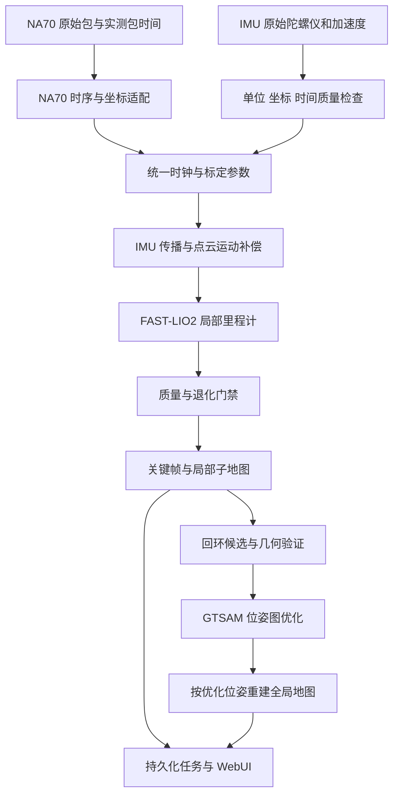

# NA70＋IMU 激光惯性 SLAM 开发计划

日期：2026-10-29（2026-10-30 更新）。状态：`SOFTWARE_PREPARATION_COMPLETE / NA70_LIO_PROTOTYPE_DIAGNOSTIC_TRAJECTORY`。

2026-10-30 NA70→FAST-LIO 接入原型：在 WSL2/Humble 固定源码 `cc3c9e8` 上应用可审阅补丁（`ROS2/src/na70_lio/patches/fast_lio_na70_handler.patch`）。50 帧（5 s、1,000,000 点）真实包被 FAST-LIO 连续处理约 45 次更新，记录 27 个 `/Odometry` 位姿（最大半径 0.199 m）与 1,326 点最新配准云；但时间等级 C、单位外参、无独立真值、无完整 PCD，轨迹只作诊断，ATE/RPE `NOT_EVALUATED`。FastDDS 发现失败需 CycloneDDS，5 帧短包投递不稳定。状态 `PROTOTYPE_CONSUMED_50_FRAMES / DIAGNOSTIC_TRAJECTORY_ONLY / ACCURACY_NOT_EVALUATED`，详见 [原型报告](evidence/slam/20261030-na70-fastlio-prototype/REPORT.md)。S0–S5 门禁不因此通过。

2026-10-30 首批软件开发完成：[任务清单](NA70_SLAM无数据开发任务.md)、[开发报告](evidence/slam/20261030-development/REPORT.md)。新增独立输入预检核心/CLI、13 项契约测试、固定版本构建和公开数据回放工具。Windows 后端 420 passed / 2 skipped；WSL2/Humble 的 FAST-LIO2/GLIM CPU 均构建成功，公开 Ouster＋IMU 30 s 回放有轨迹/子地图产物（含 IMU 覆盖警告）。本套 NA70＋USB IMU 仍无同步实测；S0–S5 不因此通过。

2026-10-30 无新数据阶段补充：已完成[非重复扫描 SLAM 代码调研](../docs/NA70_NONREPETITIVE_SLAM_CODE_SURVEY.md)和固定版本/源码清单，未构建或运行。FAST-LIO2 ROS2 保留为首个局部前端候选，新增 GLIM CPU 为完整建图对照；开发回环前优先评估现成后端。新增的软件准备 P0–P5 可在现场数据到位前做，但不改变下述 S0–S5 真实门禁。

用户已确认雷达为 NA70，IMU 通过 USB 输出，第一阶段采用手持或小车、在操场/室外建图，并要求先设计下一步 SLAM 方案。本轮交付设计、实施顺序和验收合同，不代表已完成驱动接入、同步、标定或 SLAM 实验。

## 1. 本次路线决策与首个交付目标

新的移动建图路线采用 **LiDAR＋IMU 紧耦合里程计 → 关键帧/子地图 → 回环验证 → 位姿图优化 → 地图重建与重定位**。不恢复历史无 IMU 的 ICP 链作为生产定位前端。足球门、导线和转台的代码、证据及未通过状态全部保留；本计划是本轮新增 SLAM 工作的执行入口，不改写那些任务的验收结论。

首个交付物是“一套可重复录制、可检查时钟和外参、能在低速移动下输出可信局部轨迹的 NA70＋IMU 数据与回放链”。先完成 S0–S2，再验证 S3 里程计。S4 回环和全局优化通过之前，产品结果称为“激光惯性里程计与局部建图”。

已确认条件与 S0 待核实项如下：

| 项目 | 已确认条件 / 待确认项 |
|---|---|
| 雷达 | 用户确认仍为 NA70；具体固件和时序能力由 S0 核实 |
| IMU | 用户确认通过 USB 输出；型号、六轴原始数据、采样频率、量程、时间戳语义及 USB 数据协议待核实 |
| 同步 | PPS/PTP/触发能力未知，不能因设备有时间字段就判定已同步 |
| 安装 | 用户选择手持或小车；雷达和 IMU 须安装在同一刚性载体，具体支架和外参待核实；首轮低速，不进入飞行验收 |
| 场景 | 用户选择操场/室外；采集顺序为先墙面、转角、立柱等结构丰富区域，再沿操场边缘，最后测试开阔地退化 |
| 其他传感器 | 第一版不要求 GNSS、相机或轮速，也不假设有绝对航向或地理坐标 |

## 2. 仓库基线与必须避免的历史问题

1. [历史总计划](MASTER_开发与验收总计划.md) 和 [KISS-ICP 探针](evidence/mapping-repair/20260914-playground/kissicp-se2-probe-20260914.md) 已记录：100 包只是约 0.1 s 的兼容帧，不是完整重复扫描。静止 PCAP 在短窗下产生大量假运动；较长积累改善覆盖，但不能直接用未补偿长窗处理运动数据。
2. [Sweep 配置反馈](evidence/mapping-repair/20260914-sweeps/registration-input-feedback-20260914.md) 表明：角域粗分箱覆盖通过，不等于配准几何足够。新前端仍需报告有效点、结构方向、重合和可观测性。
3. `web/backend/decoder.py`、`na70_core/observations.py` 当前只确认包级设备时间；经典 PCAP 内没有已验证的逐点测量时刻。现有时间解析精度为毫秒级，包时间对应首点、末点还是打包时刻仍须核对厂家资料。
4. `inno_device_lidar_node.cpp` 当前用 `i*5000 + packet_index*1000000` 构造 `offset_time`。它是推算值，不是已验证的逐点硬件时间；不能凭字段存在宣称逐点去畸变。设备时间异常时回退主机时间的行为也须在新适配器中显式标记，不能混入同一时钟域。
5. 驱动的 `double_wedge_driver/CustomMsg` 与 FAST-LIO 所订阅的 `livox_ros_driver2/CustomMsg` 是不同消息类型，改 topic 名称无法直接互通。现有合帧 `test_lidar_driver.cpp` 输出 XYZI，并以末包作为帧时间；丢掉了帧内各包时序，不作为新 LIO 的唯一输入。
6. `lidar_frame`、`lidar_link`、安装轴变换及 factory 角度修正需对账。同一坐标旋转只能应用一次，不能用修改 `frame_id` 代替真正的坐标变换。
7. 旧 PCAP 无同步 IMU，只保留为协议、扫描覆盖和失败回归。今天新增 IMU 无法补回历史运动过程的惯性观测。

IMU 提供短时运动预测和重力约束，不会消除低成本惯导的积分漂移。单一远场地面仍缺少平面内定位约束；不能承诺仅加 IMU 就能稳定重建完整操场。

## 3. 技术选型

| 组件 | 设计选择 | 理由与进入条件 |
|---|---|---|
| LIO 前端 | **FAST-LIO2，优先审核上游 `ROS2` 分支** | 直接点到地图更新、支持外置 IMU，适合作为固态扫描适配起点；NA70 不在其现成传感器类型中，需专用输入适配 |
| 完整建图对照 | GLIM CPU＋ROS2 wrapper | 2026-10-30 核对到非重复扫描支持、通用时间配置与现有全局后端；先公开数据验证，NA70 适配和 4GB ARM 资源仍未验证 |
| 初始标定 | 机械初测＋重复动态标定；LI-Init 为候选离线工具 | 估计时间偏移、外参、重力和 bias；其 NA70 输入、ROS 环境和激励条件也要验证，不能把工具安装当成标定通过 |
| 回环 | 首版先做空间/时间候选筛选＋子地图几何验证 | 候选不是约束；局部漂移包络外找不到候选时，才评估地点描述子，不首轮并行引入多套检索框架 |
| 位姿图 | S4 使用成熟全局后端，GTSAM `Pose3` 为原方案 | 优先评估 GLIM 或现成回环模块，避免首轮自行编写后端；若采用原方案，首版离线批优化，确需在线回环时再引入增量调度 |
| 地图与可视化 | 复用现有体素融合、分块、导出、WebUI 与任务证据结构 | 不重写 Web 点云系统；地图由通过质量门的位姿驱动 |

FAST-LIO2 是本项目的候选基线，不是 NA70 已验证方案。S3 若在同步、标定合格和结构丰富采集上仍失败，先定位输入时序、扫描覆盖和几何退化，再决定是否引入另一前端。

LIO-SAM 的标准输入依赖逐点相对时间及 ring/机械扫描组织，不选作 NA70 第一适配入口。Point-LIO 留作后续快速运动对照；当前包内采样时刻未确认，先不增加逐点高频状态更新的适配成本。这些是基于输入条件的工程选择，不是算法优劣结论。[FAST-LIO2 说明](https://github.com/hku-mars/FAST_LIO/tree/ROS2)、[传感器预处理类型](https://github.com/hku-mars/FAST_LIO/blob/ROS2/src/preprocess.h)、[LIO-SAM 输入要求](https://github.com/TixiaoShan/LIO-SAM#prepare-lidar-data)、[Point-LIO 时间要求](https://github.com/hku-mars/Point-LIO)。

实施前固定仓库、commit、submodule 和依赖版本，并保存补丁及构建命令。FAST-LIO 仓库 `LICENSE` 为 GPLv2，部分包元数据标注不同，应按固定版本的实际许可文件记录；GTSAM 和标定工具也保存对应许可清单。本轮不下载或安装这些依赖。

## 4. 系统结构与仓库接入边界



- NA70 UDP 解码仍以 ROS2 驱动为参考；经典 PCAP 仍只由 `backend/decoder.py` 解析。复用 `RayBatch` 原始引用契约及现有包窗/Sweep 事实，不另写第三套 PCAP 解析器。
- 新增 ROS2 适配层只负责时间、坐标、字段和质量，不重写滤波器。建议未来集中在 `ROS2/src/na70_lio/`，由同一 launch 启动适配器和固定版本 FAST-LIO；算法修改保持为可审阅的 NA70 预处理补丁。
- 新点云输入采用保留真实相对时间和源索引的 `PointCloud2`，由专用 NA70 handler 读取；不伪造 ring，也不冒充 Livox 设备。若采用包级近似，时间质量与误差界必须随运行保存。
- Windows 继续承担数据审计、评分、WebUI 和报告；LIO C++ 核心在 Linux/Humble 回放。**本计划新增例外：允许 WSL2/Humble 作为 LIO 离线算法验证环境**；它不能证明设备接入延迟、ARM 性能或 Jetson 实时性。首次硬件采集在有可靠设备访问的 Linux/Jetson 运行。
- Web 正式任务仍由 `POST /api/mapping/jobs` 与 `mapping_jobs.py` 管理；后续增加显式 `lidar_imu` 配置和 `sensor_session_id`，通过受控离线 worker 导入轨迹/关键帧。不得把新的 SLAM 混入旧 `fixed_sensor`，也不新增另一条 Web 配准入口。ROS2 命令行实验属于离线验证，不是另一套 Web 生产算法。
- 数据导入优先采用运行完成后的不可变结果包。实时连接推迟至 S5；仍用 HTTP 轮询，不新增 WebSocket。

质量门必须接入 FAST-LIO 的内部局部地图写入环节，不能仅在 Web 导出时拒绝一帧、却已经把它加入 ikd-Tree。S3 的最小算法改动应包含 NA70 预处理、测量质量日志及地图更新门控；不假设上游已有本项目所需的退化状态和 source 引用输出。体素代表点的来源通过成员引用或 sidecar 保存，不把质心冒充某个实测原始点。

### 4.1 坐标与状态合同

统一记号 `T_AB` 表示把 B 系坐标变换到 A 系。外参固定为 `T_IL`（LiDAR → IMU），同时记录实际厂商轴系和转换矩阵。TF 树采用 `map → odom → base_link`，`base_link → imu_link/lidar_link` 为刚性静态变换。

`odom` 保存连续局部轨迹；回环修正 `map → odom`，不回写为局部里程计突跳。无 GNSS/绝对航向时，原点与初始 yaw 是本地约定，不能把轨迹标成 ENU 地理真值。遵循 [REP-105](https://github.com/ros-infrastructure/rep/blob/master/rep-0105.rst)。

前端估计姿态、位置、速度、陀螺仪/加速度 bias 等状态；首轮使用离线标定外参，不在几何退化段同时自由估计外参和时间偏移。

状态至少包含 `INITIALIZING / TRACKING / DEGRADED / LOST`，并单独记录 `lidar_update_accepted`、`imu_only_prediction`、`map_fusion_allowed`、`segment_id`。IMU 单独传播不能标成激光测量确认；缺时、饱和、明显退化及失锁段禁止污染地图。重初始化开启新段，未经验证的重定位约束不得把两段强行拼接。

退化检查需分别记录激光测量的信息与融合后协方差：先归一化旋转/平移量纲，再看激光约束的弱方向，并联合残差、重叠与 IMU 创新判断。不能因 IMU 先验让总矩阵满秩，就声称激光六自由度均可观测。只有包围当前时刻的激光更新合格，才把相应地图片段标成可信当前测量。

## 5. 时间同步与运动补偿：首轮最高优先级

### 5.1 三档时间能力

| 等级 | 时间来源 | 可支持的实验口径 |
|---|---|---|
| A | 设备真实逐点时刻，或经厂家确认并实测验证的包内采样模型 | 在同步、标定与误差预算通过后进行逐点运动补偿 |
| B | 只有实测包时间，将包内点赋为同一代表时刻 | 明确为包级近似补偿；仅在速度、角速度、距离和包内不确定度共同满足误差预算时可验收 |
| C | 只有未校准主机到达时间，或不确定的序号推算时间 | 数据诊断与静止对照，不进入动态 SLAM 验收 |

不能默认 NA70 已具备 A。B 也不等于不可用：先核实包内采样跨度和时间戳位置，再测得低速工作包络。如果误差过大，则改同步方式、限制运动/有效距离或要求更高时间能力，不用虚构微秒时间补齐字段。

同步优先顺序：设备确实支持的共用硬件时钟/触发/PPS/PTP → 可校验的设备时钟映射 → 软件偏移和漂移估计。PPS 是否只提供秒边沿、是否还需绝对时间报文，必须核实。两台设备“同接一台电脑”、GPS 格式标志或 ROS 时间相近均不是同步证据。

每段保存设备原时钟、接收时钟、ROS header、时间单位和 `t_ref = a*(t_device-t0)+b` 映射；设备重启、倒退或跳变断段。不能用 rosbag 录制时刻或回放 `/clock` 替代传感器采样时刻。同步评估覆盖开始/中间/结束，区分固定偏移、漂移和传输抖动。

**USB IMU 专项**：USB 只说明传输链路，不说明采样时钟与雷达同步，也不据此认定设备支持或不支持 PPS。先检查每条样本是否含设备采样时间、序列号/计数器以及批次信息；保留主机单调接收时间用于延迟和抖动诊断。若多样本在一次 USB 读取中批量到达，按各自真实设备时序拆分，不把同一次读取时间当全部采样时刻，也不直接用主机读取频率报告 IMU 采样频率。明确计数器单位、回绕和重启；没有设备时间时，不得只按标称 Hz 倒推样本时刻便宣称同步通过，须保留不确定度并验证，否则保持 C 级诊断。

### 5.2 时间误差预算

用一阶保守估计 `e_time ≈ (v + r*|ω|)*δt`，其中 δt 包括同步残差、设备时间量化、包时间语义和包内采样近似误差。独立测量或交叉验证应给出其上界；没有可信上界，标记 `NOT_EVALUATED`。

- 设计例：v=0.5 m/s、r=50 m、ω=10°/s，时间误差预算 0.02 m 对应 δt 约 2.17 ms。
- 设计例：v=1 m/s、r=200 m、ω=30°/s，预算 0.05 m 对应 δt 约 0.47 ms。

以上是误差敏感度计算，不是设备精度实测。远距离点可用于显示，但不能自动进入精密位姿约束或被报告为同样的地图精度。外参、姿态和测距误差另算；例如 0.1° 角度误差在 200 m 约形成 0.35 m 横向误差。

### 5.3 去畸变和扫描组织

以窗口末时刻 `t_r` 为参考，运动补偿遵循：

`p_Lr = inverse(T_WI(t_r)*T_IL) * T_WI(t_i)*T_IL * p_Li`。

`t_i` 的质量等级必须可追溯。IMU 序列需覆盖完整窗口并提供插值边界，禁止悄悄外推长缺口；参数依据实际采样频率、噪声和误差预算冻结。

保留 100 包 UI 帧，不把它当完整扫描。S2/S3 在同一数据上比较 **50/100/200 ms 非重叠更新批次**，另外评估经运动补偿后的局部地图覆盖。它们只是实验档，不预定最佳时长；低密度时报告降级，不直接把未补偿窗口拉到数秒。首版不反复把重叠滑窗中的同一原始点当新测量；每个 source ID 记录使用与地图归属，避免重复信息导致假置信。

如果三档短窗在结构丰富场景中仍无足够约束，可增加 0.5/1 s **经运动补偿**的对照，但必须另报更新率、等待延迟和 IMU 传播不确定度，不能继续沿用 10 Hz 指标；若低延迟和足够几何不可同时满足，则调整安装/采集或重新选型，不把历史长窗静止成功外推成动态实时成功。

## 6. IMU、外参与采集设计

IMU 输入使用陀螺仪 rad/s、加速度 m/s²；确认输入是包含重力响应的原始比力，而不是已去重力的运动加速度。检查右手轴系、NED/ENU、量程、饱和、温度和采样滤波延迟。设备姿态四元数作为诊断项，不默认依赖磁力计或把厂商姿态当独立真值。无 orientation 时按消息约定声明未提供；协方差未知不能被滤波器当作零噪声。参照 [REP-145](https://github.com/ros-infrastructure/rep/blob/master/rep-0145.rst)。

USB 接入先确认是虚拟串口、HID 还是厂商 SDK，优先复用对应厂商驱动；暂不预设串口号、波特率或自定义解析器。首份短录制须包含原始接收字节/报文和解析后的 gyro、acc、设备时间、接收时间、序列号（无字段则明确缺失），据此决定能否输出可靠 `/imu/data_raw`。如果设备只提供融合姿态，还须确认原始 gyro/acc 是否可开启，不能仅凭姿态输出视为满足紧耦合 LIO 输入。

频率先以 200 Hz 及以上为设计起点，是否可用由实际输出频率、丢样和运动包络决定，不因标称频率通过就验收。静止测量能初估 gyro bias、重力方向和噪声，**不能仅凭一次静止姿态解出完整加速度 bias、比例因子和绝对 yaw**。

采集清单采用同一刚性安装、同次会话的雷达＋IMU 原始数据：

| 数据集 | 建议采集 | 用途 |
|---|---|---|
| C0 静止与轴系 | 预热后静止 10–20 分钟；另做六面静置和各轴转动 | 频率/时钟、噪声、偏置稳定性、量程与符号；完整 Allan 分析仅在记录足够长时使用 |
| C1 标定激励 | 结构丰富场景下温和三轴旋转及多方向平移，至少 3 次独立录制 | 联合检查外参/时间偏移的可观测性和重复性，不靠单轴转台解决全部外参 |
| D1 低速基本动作 | 静止→直行 10–20 m→停稳→返回，及已测角度转动，各 3 次 | 去畸变、平移和旋转基线 |
| D2 小闭环 | 结构丰富区域 50–100 m 闭合路线，至少 3 次 | 前端漂移与回环正样本 |
| D3 困难负例 | 长相似围栏、空旷地面、行人穿行及轻微振动 | 退化检测、动态污染和假回环拒绝 |
| V 独立验证 | 保留未调参录制；另一次采集会话复访，条件允许再重装复标 | 冻结验证与跨会话重定位 |

每次开始/结束静止约 10 s；上述时长和路径是采集建议，不是已有数据。按完整录制划分开发与验证，不能把相邻重叠窗口分到两侧。

原始保存优先为 rosbag2（原始雷达包/保留时序的包消息、`/imu/data_raw`、设备状态、`/tf_static`），必要时同时录 PCAP 和厂商 IMU 原始日志；两者通过会话 manifest 关联。参考位置/姿态必须独立获得：量测标志点、固定工装、可用的全站仪/RTK/动捕等按现场条件选择；不能把 LIO、自带未经验证的姿态或优化后的闭环当真值。

无连续独立轨迹时，只报告实测端点、已测距离、地图控制点等离散指标，ATE/RPE 写 `NOT_EVALUATED`。起终点物理复位的一致性也不等于整条轨迹准确。

## 7. 实施阶段与退出门禁

| 阶段 | 工作与交付 | 退出条件 |
|---|---|---|
| **S0 硬件与数据合同** | 型号/固件/接口表、时钟语义、刚性安装图；确认设备原始数据可录，固定依赖版本 | 原始 gyro/acc 与雷达时序可读；轴系、单位、时间等级已明确；未知项逐条记录，不以“已有 IMU”代替检查 |
| **S1 同步采集与质量审计** | 最小 IMU 接入、保留包时间的 NA70 输入、会话 manifest；输出时间差/频率/缺口/重启报告 | 同一次录制可重复回放；原时间不丢失；坏时间和缺口被识别；同步上界满足第一档低速误差预算 |
| **S2 标定与运动补偿** | `T_IL`、时钟模型、噪声/bias 配置；无补偿/旋转补偿/完整补偿对照 | 3 次标定在留出动作中一致；墙/柱的运动展宽降低且没有反向扭曲；源引用、正逆变换、量化和包级近似边界有测试 |
| **S3 局部 LIO** | 固定 FAST-LIO2 ROS2 版本＋NA70 handler；基本动作、3 档更新时长、退化状态和子地图 | 静止、已测平移/旋转和闭环前轨迹达到冻结目标；失败不融合，失锁不强接；稀疏与开阔场景能如实降级 |
| **S4 回环与全局 SLAM** | 子地图几何验证、回环日志、GTSAM 图、优化前后轨迹与重建地图 | reviewed 真回环通过、相似围栏负例被拒；控制点/留出几何改善，无折叠地图；优化后地图按新位姿重建；独立会话完成重定位 |
| **S5 产品接入与部署验收** | 现有 mapping job 接入、WebUI 显示来源/质量/双轨迹、证据包；Jetson/Humble 回放与实时采集 | 任务重启恢复/取消/坏输入行为正确；独立真实数据冻结验收；Jetson 时间、内存、温度、队列和长测达标 |

S4 的回环候选必须经过时间间隔、双向重叠、非退化几何、配准残差和相邻关键帧一致性验证。阈值由开发数据冻结；不因空间接近就加边，不因一次 ICP 收敛就判回环。NA70 有限视场需要设计方向与可见结构重合的复访，不能假定闭合路线天然可见同一处结构。

位姿图首节点固定规范自由度；顺序边来自前端相对位姿，回环边仅来自通过验证的几何约束。记录信息矩阵来源和保守噪声，不能把高度相关的 LIO 后验边假定成完全独立高置信测量，也不把同一 IMU 原始量在后端重复作为独立约束叠加。首版对回环使用稳健处理，并保留关闭回环的基线。[GTSAM Pose3 示例](https://github.com/borglab/gtsam/blob/develop/examples/Pose3SLAMExample_g2o.cpp)。

## 8. 验收指标与证据口径

以下数字为 **DRAFT_TARGET，待硬件事实与开发基线确认后、独立验证之前冻结**，不是当前性能或设备能力承诺。若测得不达标，先如实 FAIL，再通过有记录的方案修订改变目标；不得在查看验证结果后静默放宽。

| 项目 | 第一版建议目标与统计方式 |
|---|---|
| 时间 | 低速首档 δt 总上界满足 §5 的误差预算；不同距离/角速度分别列包络，无法界定则不验收动态数据 |
| 标定重复性 | 3 次独立估计的旋转差 ≤0.2°、平移差 ≤2 cm；这只是重复性检查，仍须留出动作和几何验证 |
| 静止局部轨迹 | 60 s 内相对起点的位置偏移 P95≤0.10 m、旋转偏差 P95≤0.5°；同时列累计假路径、最大偏移和是否发生激光更新，不靠强制零速伪造稳定 |
| 基本移动 | 10–20 m 独立测距动作端点误差 ≤0.20 m；旋转工装角度误差 ≤1°；计入参考测量误差 |
| 闭环前里程计 | 50–100 m 路线物理复位后，位置闭合误差 ≤max(0.30 m, 路长×1%)；不使用回环修正后的结果冒充前端精度 |
| 全局地图 | 先在 30–50 m 工作距离评测，独立控制结构/重复墙面距离残差 P95≤0.20 m；报告采样、控制点不确定度和远距离分层，200 m 精度单独评估 |
| 真/假回环 | 逐对人工复核候选；冻结负例集误接受为 0，同时报告正例命中分母和拒绝理由；有限测试集为 0 不外推为现实绝无误回环 |
| 故障 | 注入 IMU 缺口/饱和/时间倒退、雷达断流、不同步和错误外参；均应诊断并停止不可信融合，不允许长期 IMU 外推变成正常地图 |
| Jetson 性能 | 暂定 10 Hz 激光更新、≥100 Hz 位姿输出；单批处理 P95<100 ms 且长期无积压，若批次不同必须按实际时长重设预算；端到端延迟另测 |
| 资源与稳定性 | Orin Nano 4GB，SLAM 进程树峰值 RSS 初始预算≤2 GB、系统无 OOM/持续 swap/热降频；30 min 长测，局部地图/缓存/队列有界，关键帧和全局地图增量落盘 |

评价 LIO 轨迹时，只有独立连续真值可计算 ATE/RPE；使用 SE(3) 刚体对齐并声明规范自由度，不使用缩放拟合掩盖米制误差。地图留出结构不参与该次配准，避免用优化目标自身的残差充当独立准确度。

性能分别记录 `WINDOWS_LOCAL`（审计/Web）、`WSL2_HUMBLE_X86_64`（离线 LIO）、`JETSON_ORIN_NANO_HUMBLE_ARM64`（最终目标），包含硬件、功耗模式、线程、软件版本、输入 SHA、播放倍率、处理/等待/端到端延迟和峰值内存口径。

## 9. 数据与运行产物

原始数据建议位于 `radar_capture_data/lidar-imu/<session_id>/`（实施时确认忽略规则，不入 Git）；每个会话包含雷达/IMU/bag 文件哈希、设备固件、安装图、时钟和配置标识。原始测量不被去畸变或滤波结果覆盖。

每次运行使用唯一 `run_id`，沿用现有 mapping job 目录与原子落盘习惯，按阶段生成必要文件：

```text
manifest.json                 # 完整命令、版本、输入、环境、时间等级
calibration.yaml              # 外参、时钟模型、噪声、标定来源与有效会话
time_quality.json              # 原时钟/映射/偏移/漂移/缺口与误差包络
trajectory_odom.csv            # 时间、T_odom_body、质量、bias、segment
frame_quality.jsonl            # 当前测量/惯导预测/退化/融合与拒绝理由
keyframes.json + source_refs   # 源包/源点、参考时刻与子地图归属
loops.jsonl + pose_graph       # S4 才生成：候选、接受/拒绝和优化约束
trajectory_map.csv            # S4 才生成：优化后轨迹，不覆盖 odom 轨迹
map.ply / map.pcd + map_chunks
validation.json + REPORT.md + export/mapping-evidence.zip
```

S0–S2 证据保存到 `Plan/evidence/slam/<run_id>/`，没有结果时不创建伪运行包。必须保存失败。WebUI 后续显示“输入有效、同步合格、标定版本、IMU 预测、激光更新、退化、地图融合、回环版本”，不能用一盏绿色状态灯掩盖各层条件。

## 10. 第一批实施任务与下一步

**无新现场数据时先做软件准备**：代码版本和依赖固定 → Humble 基线构建 → 作者公开数据回放 → NA70/USB IMU 输入合同与最小合成契约测试，具体范围见[调研 §4](../docs/NA70_NONREPETITIVE_SLAM_CODE_SURVEY.md#4-没有新数据时可以先推进的任务)。本轮只完成代码调研；构建、公开数据回放和合成验证未执行，也不作为 S1–S3 的 NA70 实测通过证据。

严格按依赖推进，首批范围限于 S0–S2：

1. 已确认 NA70＋USB IMU、手持/小车、操场/室外。下一步补齐 IMU 型号/固件、USB 协议、原始 gyro/acc、采样时钟与同步能力表；用首份短录制验证，不重复把已确认场景列为未知。
2. 核对 NA70 包时间语义、包内采样规律、实际输出速率；审计现有推算 `offset_time`，明确哪些字段必须替换或降级标记。
3. 用原始雷达＋IMU 做一次同步采集，建立会话 manifest，先产出时间质量报告。
4. 检查 IMU 单位、轴向、六面静置、各轴转动、频率与饱和；保存机械外参初值。
5. 完成三次标定激励及留出录制，决定采用 A 还是 B 时间等级、冻结第一档低速工作包络。
6. 验证运动补偿公式、外参正逆、包级时间近似和源点引用，并输出真实墙面/立柱对照。
7. S0–S2 通过后再接入 FAST-LIO2，先完成静止＋直行返回的 S3 小闭环；此前不投入回环后端和新 WebUI 页面。

计划阶段无需安装依赖、修改驱动、重新运行 SLAM 或填写虚构性能。实施前的仓库工程参考：2026-10-29 Windows 后端回归 407 passed / 2 skipped；前端生产构建通过。这只证明既有工程回归，与 SLAM 门禁无关。

## 11. 核对过的一手资料（2026-10-29）

- [FAST-LIO ROS2 分支](https://github.com/hku-mars/FAST_LIO/tree/ROS2)：Humble 环境、外部 IMU、输入同步及时间字段要求；其性能数字不外推为 NA70/Jetson 结果。
- [FAST-LIO ROS2 preprocess.h](https://github.com/hku-mars/FAST_LIO/blob/ROS2/src/preprocess.h)：当前传感器类型与点字段，需单独适配 NA70。
- [LI-Init](https://github.com/hku-mars/LiDAR_IMU_Init)：时空外参初始化与运动激励；不默认该工具已支持本设备。
- [LIO-SAM](https://github.com/TixiaoShan/LIO-SAM)：标准输入的点时间与 ring 要求。
- [Point-LIO](https://github.com/hku-mars/Point-LIO)：采样时刻与 IMU 输入要求。
- [GTSAM Pose3 示例](https://github.com/borglab/gtsam/blob/develop/examples/Pose3SLAMExample_g2o.cpp)：位姿图优化与首节点规范约束。
- [REP-105](https://github.com/ros-infrastructure/rep/blob/master/rep-0105.rst)、[REP-145](https://github.com/ros-infrastructure/rep/blob/master/rep-0145.rst)：坐标与 IMU 观测约定。
