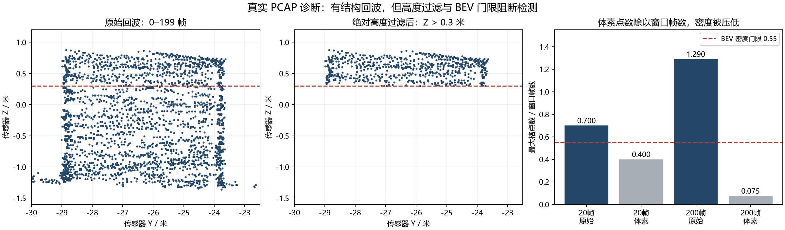

# 球门识别失败根因排查

日期：2026-09-20。环境：Windows / Python 3.12.10。任务：GOAL-P3.6。

**真实点云存在清晰的球门状结构，但处理链在 BEV 提议和三维柱提取两个位置阻断它。已修复地面估计的一处回退缺陷；真实球门识别仍 FAIL，P3 不退出。**

输入：`radar_capture_data/2/9.14_caochangyou.pcap`，1211 帧。SHA-256：`ceca9fc08758f3c35f7b8b1c024bdab90e65f49ab65e39102cdd58dc0c5292db`。沿用现有解码器，未改标注、生产阈值或锁定标准。



左、中图为帧 0–199 的原始点局部投影，仍为传感器坐标；红线是绝对 Z 门限。右图统计配置 ROI 内最大 BEV 格点数，原始与体素结果使用相同窗口。这是诊断图，不是已复核逐点真值，也不代表单帧观测完整。

## 1. 高度门限与真实安装高度不一致

`GoalDetector.detect()` 先要求 `z > 0.3`，`find_poles()` 再要求剩余点的 z 跨度达到 1.8 米。未完成地面归一化时，0.3 指相对雷达原点的绝对高度，并非离地高度。

帧 0–199 的局部结构在 X 约 94 米、Y 约 -29 至 -24 米。取 X∈[93,96]、Y=-28.8/-23.8±0.4 米的两个边缘诊断邻域：

| Y 中心 | 原始点数 | 原始 Z 范围 / m | 原始跨度 / m | Z>0.3 后点数 | 剩余跨度 / m |
|---|---:|---|---:|---:|---:|
| -28.8 | 454 | -1.267～0.874 | 2.141 | 105 | 0.541 |
| -23.8 | 354 | -1.364～0.742 | 2.106 | 81 | 0.440 |

邻域含背景，不将极值当作实测门柱尺寸。但过滤后不足 0.6 米的跨度无法通过 1.8 米柱高条件，是直接可复现的失败机制。修复前地面归一化只在 13/1211 帧启用。

代码：`web/backend/goal_detection/detector.py` 的 `z_height`、`geometry.py:find_poles`、`pipeline.py:_estimate_ground_level`。

## 2. BEV 将体素代表点数当作逐帧回波密度

生产路径先用 0.5 米体素合并观测，再计算 `体素代表点数 / 窗口帧数`。窗口增加时，同一空间的体素数趋于饱和，分母却继续增加。

| 窗口 | 原始 ROI 点数 | 体素点数 | 原始最大格点数 | 体素最大格点数 | 格点数门限 |
|---|---:|---:|---:|---:|---:|
| 64–83（20 帧） | 437 | 202 | 14 | 8 | 11 |
| 308–327（20 帧） | 689 | 289 | 18 | 8 | 11 |
| 0–199（200 帧） | 5428 | 1126 | 258 | 15 | 110 |

三者均触发 `no_dense_cells`，三维检测得不到搜索区域。基线全片 1207 次 BEV 调用中只有 207 次产生区域；前 595 帧只有 1 帧产生区域，0 帧产生累积候选。

这证明统计量与阈值口径不相容，**不授权恢复已被真实数据否决的“原始观测次数直接加权”方案**。应分别评价空间占据、独立时间观测和结构几何，用真实目标及树/围栏负样本重建提议门禁。

## 3. 球网将柱身连接成宽组件

原始点在两侧边缘之间有网状回波。局部 fallback 分离了横梁高度层，却仍用柱身层的三维连通组件作种子，球网会把两侧连起来。

仅作诊断：将帧 0–199 原始 z 加 1.3 米，检查现有柱身层（0.3～1.8 米）和 0.8 米连通半径。主组件包含 1513 点，XY 相对中位中心的 RMS 半径为 1.774 米，超过 `max_radius=1.2 m`，因此触发 `seed_radius_too_large`。1.3 米是隔离高度影响的诊断干预，不是新标定值。

取消体素压缩、或使用 0.1 米体素并作上述高度补偿，所查前段窗口仍无完整候选：部分只有一根柱，主体仍被判为宽组件。仅增加叠加帧数不充分。后续应从网面中提取两侧边界/竖向线，再验证上沿和宽高，不能要求整个连通组件像孤立柱。

## 4. 标注尺寸与固定 ROI 干扰了旧解释

`AnnotateApp.tsx` 的 `GOAL_DEFAULT` 为 `[0.6,7.32,2.44]`。主 PCAP 的旧框保留该宽高且为 `PENDING_REVIEW`，不能视为实测尺寸。当前原始结构的 Y 向投影宽约 5 米，也不能直接替代现场尺寸。

旧 `annotation-window-audit.json` 依据 7.32 米框在 Y≈-30.19/-22.87 寻找两柱，与当前结构边缘不一致。因此“左柱邻域 0 点”只能说明那个假定邻域无点，不能单独证明球门缺柱或标注时间错位。本轮不认定时间一定正确，需将尺寸、位置、时间和窗口一起复核，未重写标签。

固定 demo ROI 为 `[84,104,-36,-17,-2,6]`，另一标注中心 `[79.75,6.7,1]` 在累积 ROI 外。雷达转动后，这个固定 sensor ROI 不能保证仍覆盖同一实体；后段点云变为斜向长结构，候选未经真值复核，不能把出现候选视为检出球门。

## 5. 已修复的代码缺陷及结果

修复 `_estimate_ground_level` 的来源选择：先对当前帧作 finite/range/ROI/低分位筛选；有效点不足时再尝试已有累积云。旧实现只在裁剪前检查帧总点数，被“20000 点完整帧”误导，裁剪后只有 19 点仍无法回退。

保留最小点数、分位数、坡度和残差门限，当前帧足够时仍优先当前帧。trace 增加 `source`、`source_attempts`。

| 同一输入与配置 | 修复前 | 修复后 |
|---|---:|---:|
| 总帧数 | 1211 | 1211 |
| 地面归一化启用 | 13 | 470（当前帧 13、累积云 457） |
| 有 BEV 提议的帧数 | 207 | 207 |
| 选中当前测量的帧数 | 24 | 6 |
| SEARCHING / CANDIDATE | 1105 / 106 | 1180 / 31 |
| LOCKED / TRACKING | 0 / 0 | 0 / 0 |
| 待复核区间命中 | 0/11 | 0/11 |

候选减少不能解释为准确率改善或退化，缺乏已复核真值。修复证明回退路径恢复，不证明所有拟合面都是真实地面；运动混合窗口仍需验证。帧 83 的累积地面带也只有 71 点，低于 100 点门限，仍拒绝，不强行输出平面。

## 6. 验证与复现

- 后端 `web/.venv/Scripts/python.exe -m pytest tests -q`（工作目录 `web`）：**270 passed**。新增 2 项测试覆盖 ROI 后不足、低分位后不足、当前帧优先与双源不足。
- 前端 `npm run build`（工作目录 `web/frontend`）：通过。前端交互未修改，本轮未重跑浏览器 E2E。
- SYNTHETIC：static、translation_yaw、pitch_roll、density_drop、missing_crossbar、disappear_reenter、tree_wall_fence；seed 0/1000，各 200 帧，共 2800 帧。14 个 case 的全部已报告 metrics 与 `20260920-p3-z-leveling-release` 一致。disappear_reenter recall 仍 0.9333/0.9867，tree_wall_fence 仍 0.980/0.985，保留既有边界。
- 真实：修复前后各回放 1211 帧；待复核标注仍 0/11。Windows 耗时受并行测试影响，不作严格性能比较或 Jetson 验收。

证据目录（相对本目录）：

- `../20260920-root-cause-baseline/`：修复前逐帧结果、配置和源码哈希。
- `../20260920-root-cause-audit-v2/`：修复前正确使用完整当前帧输入的隔离实验。
- `../20260920-root-cause-ground-fix/`、`../20260920-root-cause-ground-fix-validation/`：修复后回放与评分。
- `audit.json`：当前代码的 16 个窗口、7 组几何诊断干预。直接几何探针不等于完整跟踪运行。
- `findings.json`、`derive_findings.py`、`raw-roi-*.npz`：报告数字与图的输入。
- `../20260920-root-cause-synthetic/`、`../20260920-root-cause-negative/`：SYNTHETIC 回归。
- `../20260920-root-cause-pytest.log`、`../20260920-root-cause-build.log`：工程验证。

仓库根目录 PowerShell（使用新的输出目录名，不覆盖旧证据）：

```powershell
& web/.venv/Scripts/python.exe tools/run_goal_demo_offline.py --pcap radar_capture_data/2/9.14_caochangyou.pcap --capture-id c4cc19fb-3020-4ccc-8407-1521f71b7212 --run NEW-RUN
& web/.venv/Scripts/python.exe tools/audit_goal_failure.py --pcap radar_capture_data/2/9.14_caochangyou.pcap --baseline Plan/evidence/goal-demo/NEW-RUN --output Plan/evidence/goal-demo/NEW-AUDIT
& web/.venv/Scripts/python.exe Plan/evidence/goal-demo/20260920-root-cause-audit-final/derive_findings.py
```

## 7. 下一步顺序

1. 复核前段真实结构、地面和窗口归属，建立独立真值，不用 UI 默认框反向规定目标。
2. 统一地面相对高度、柱底裁剪和完整柱高语义；加入实际安装高度的合成与真实回归。
3. 修正 BEV 体素统计口径，单独评价提议召回和背景误提议，保留已否决方案的反向回归。
4. 针对含网面/支架的结构做边界与竖线提取，解决宽连通组件拒绝。
5. 真实单窗口几何通过后，再处理固定 ROI、转动窗口污染和跟踪确认；当前不降低锁定置信度或新鲜度标准。P3 仍 FAIL / IN_PROGRESS。
