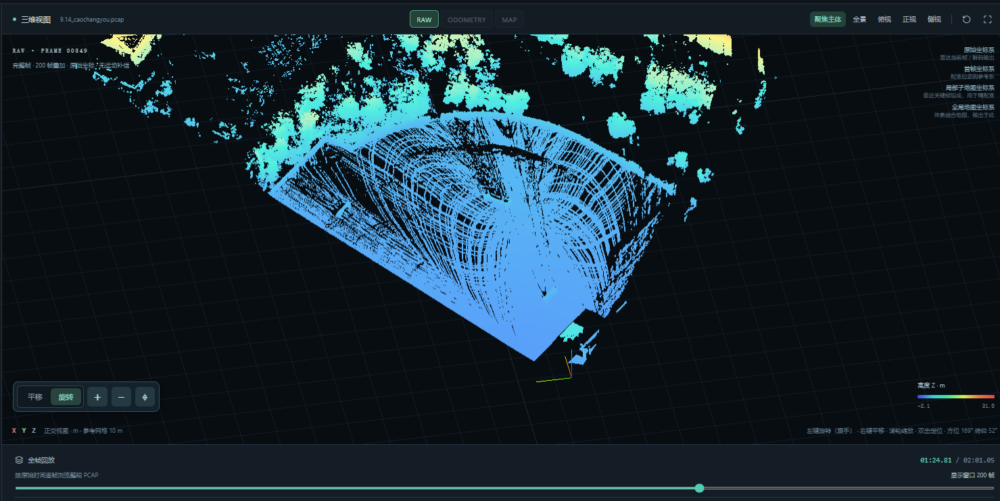
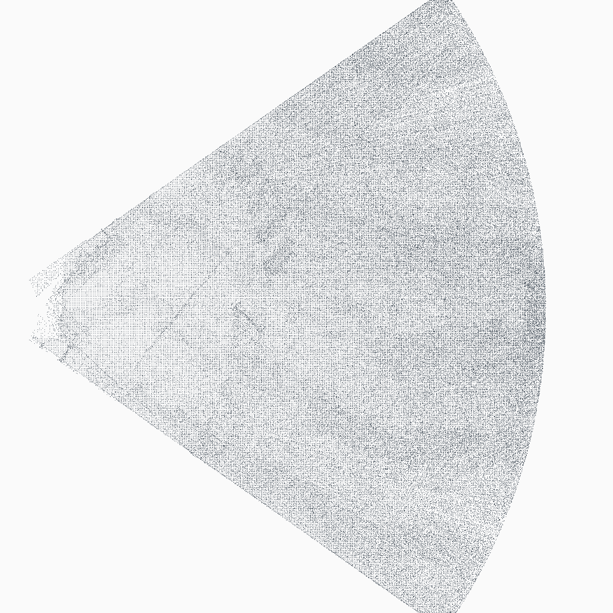
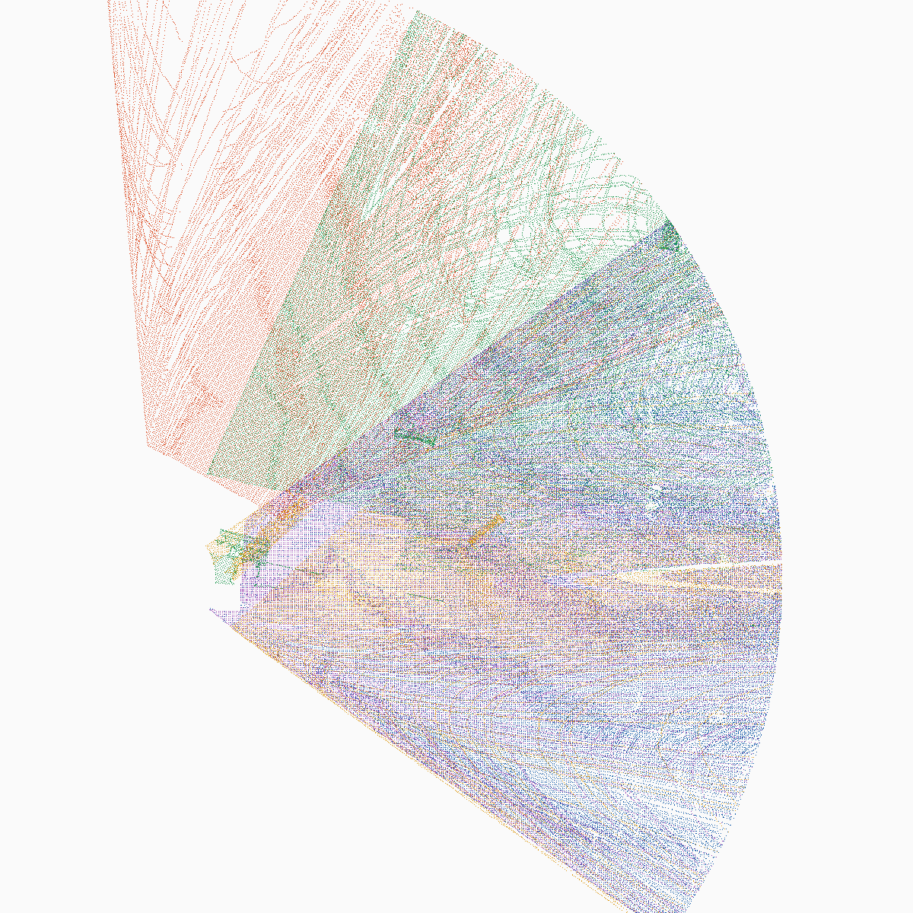
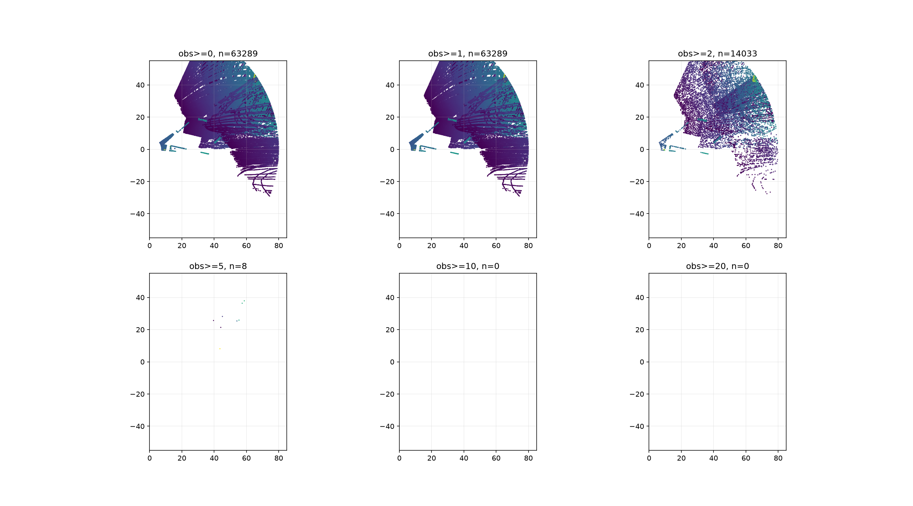

# 092324114 史博文周报

## 一、本学期任务

1. 院级大创《智能辅助驾驶闭环仿真与冗余控制系统设计》
   项目成员：史博文、戢德刀、吴奕晨、高坚钧。

2. NA70 固定俯视激光雷达移动目标感知系统
   完成雷达数据采集、动态目标提取、目标分类及 Jetson Orin Nano 端部署与验证。

## 二、本周完成情况

### 1. NA70 激光雷达项目

- 完成对 2026 年 9 月 14 日采集的四份操场 PCAP 的协议、时序、点数、距离范围和几何退化检查。四份数据均约 10 帧/s，未发现无效数据包；右侧数据中发现 1 次设备时间回退，并已在处理链中标记。
- 定位了原有配准链的关键问题：固定 100 包并不等于 NA70 的完整重复扫描，短帧点云覆盖不足，容易形成扇形条纹和错误对应。新增覆盖驱动的 SweepBuilder 后，在 0.3/0.6/1.0 m 距离阈值下，相邻覆盖率中位数达到 0.591/0.740/0.838，明显高于固定 100 包的 0.255/0.431/0.539，覆盖驱动 sweep 门禁 G1 已通过。
- 对当前生产配准链进行真实数据复跑：移动文件 944 帧中正式配准成功帧为 0、失锁 939 帧、轨迹长度为 0 m；中心文件 1298 帧主要表现为单一平面，左右文件则包含连续转动过程，均不能直接作为已知位姿的静态子图。该结果被保留为失败回归证据。
- 根据现场数据和点云重影现象，确定近期主线改为“固定点转台多视角建图”：雷达固定在转台上，每个角度停稳后采集静止点云，用转台角度和安装外参进行刚体变换，再用点云配准做小范围一致性检查。
- 完成固定点转台建图开发版，实现角度日志校验、停留时间段切分、转动段排除、雷达到旋转轴偏心变换、静止子图质量门禁、来源着色地图和证据包输出。现有 PCAP 没有同步编码器角度，因此当前结果只能标记为 `DEVELOPMENT / DIAGNOSTIC / ESTIMATED_ANGLE`，不能作为正式转台精度或完整 SLAM 验收结论。
- 对 KISS-ICP、GLIM 等无 IMU 方案进行了独立环境验证。KISS-ICP 静止 10 s 累积窗口的净位移约 2.5 cm、航向漂移约 0.02°，但短窗口仍存在噪声和错误对应；GLIM 仅在 WSL2 + ROS2 Humble + x86_64 环境下完成初步测试。两者均未接入生产链，也不能替代 Jetson Orin Nano/Humble 验证。
- 对 MapMOS 方案进行了阶段性复盘。官方预训练方案在当前 NA70 测试中未达到可用条件，已退出当前主线；现阶段保留相关代码和实验记录作为历史对照，优先解决 NA70 数据模型、位姿来源和地图融合问题。

### 2. 自动驾驶控制算法优化

- 分析现有自动驾驶横向控制算法的仿真结果，重点检查车辆轨迹跟踪误差、横向控制稳定性和控制输出变化情况。
- 在仿真模型中新增 IMU/陀螺仪数据，为车辆姿态、横摆角速度和控制状态分析提供数据基础。
- 根据当前仿真结果整理控制算法优化方向，制定下一阶段的参数调整和对比测试方案。

## 三、本周遇到的问题

### 1. 现有 PCAP 缺少真实转台角度和完整标定信息

左右操场数据是在转动雷达过程中录制的，但没有同步记录转台编码器角度、零度方向、旋转方向、回零重复性以及雷达到旋转轴的偏心距离。因此无法直接恢复每个静止子图的真实位姿。当前使用的角度只能作为几何估计值，生成的地图只能用于算法诊断，不能作为米制地图真值。

### 2. NA70 非重复扫描导致短时间点云覆盖不足

NA70 双楔镜扫描在短时间窗口内不能保证完整重复覆盖。原有固定 100 包成帧会把不同覆盖状态的点云直接送入配准，造成静止场景被误判为运动，并在转动过程中形成扇形条纹和固定物体重影。实验表明，同一静止数据从单帧窗口改为 10 s 累积窗口后，假运动规模由约 1188.6 m 降至约 0.44 m，说明帧划分和覆盖模型是当前首先需要解决的问题。

### 3. 操场场景存在明显几何退化

现有点云以远处地面和大面积平面结构为主，10 m 内稳定的立柱、栏杆、球门或墙角特征不足。地面可以约束高度、横滚和俯仰，但不能可靠约束平面内的 x/y 位移和 yaw 航向。高处部分板状结构经分析更接近树冠，属于非刚性目标，不能作为配准依据。当前真实数据的 SE(2) 候选配准接受率很低，继续单纯放宽 ICP 距离或残差门限会把错误对应误判为成功。

### 4. 运动过程缺少逐点时间，无法可靠去除扫描运动畸变

NA70 当前数据只有包级时间，缺少可信的逐点时间戳。雷达转动时，一个时间窗口内同时包含扫描覆盖变化和姿态变化，现有条件不足以进行精确的逐点去畸变。右侧 PCAP 还存在一次设备时间回退，虽然已被标记并排除出 sweep 时长计算，但说明实时处理链仍需加强时间异常处理。

### 5. 无 IMU 候选方案尚未达到生产接入条件

KISS-ICP 和 GLIM 的测试结果只能说明候选方案可以在独立环境运行，不能证明其在 NA70 操场数据上能够稳定定位和建图。KISS-ICP 还受到短窗口覆盖不足和 NA70 无逐点时间的限制；GLIM 当前只有 WSL2 x86_64 实验结果，尚未完成 Jetson ARM 环境验证。因此无 IMU 里程计暂不作为近期生产主线。

### 6. 正式硬件和独立数据验收尚未完成

当前转台开发版使用的是没有同步编码器的历史 PCAP，尚未完成真实角度采集、旋转轴偏心测量、安装姿态标定、回零重复性检查和独立复采。Jetson Orin Nano/Humble 端的 ROS2 构建、实时回放、资源占用、延迟和长时间稳定性也尚未开始正式验收。

## 四、本周技术资料调研

- **CARLA 官方文档**：用于自动驾驶仿真环境资料校对。由于 CARLA 对本地硬件资源要求较高，当前 PCAP 仿真测试暂时使用自研 LiveSim（`sim_web.py` + `sim_ui.html`）方案。
- **ROS2 Humble 官方文档**：用于 ROS2 Humble 环境迁移及 Jetson 编译问题核查，重点关注 `rclcpp::Time`、PCL/Eigen 依赖和 RViz2 配置。
- **KISS-ICP**：作为无 IMU 点云里程计候选方案进行独立测试，当前只保留诊断结果，不接入生产链。
- **GLIM**：在 WSL2 + ROS2 Humble + x86_64 环境下进行初步运行测试，结果不作为 Jetson 端验收依据。
- **ROS REP-149**：用于规范 ROS2 软件包依赖声明，继续整理 `package.xml` 中的 PCL、Eigen 等依赖项。

## 五、本周实验效果图

### 1. 原始点云转动过程中的扇形条纹与重影

下图为右侧操场 PCAP 在转动雷达后的三维点云效果，可以看到扫描覆盖形成明显的扇形区域，固定结构在不同时间段出现重叠。这是本周确定需要改进数据分帧和位姿来源的直接现象。

图 1  原始 PCAP 回放效果：转动过程中的点云覆盖变化和固定结构重影。

### 2. 原始累积地图与转台开发版来源着色地图

左图为未使用可靠外部角度时的原始累积效果，点云主要呈扇形覆盖；右图为本周完成的转台开发版来源着色结果，不同颜色代表不同静止视角的数据来源。该结果证明了处理链和地图导出流程已经跑通，但由于历史 PCAP 没有同步编码器角度，仍属于 `DEVELOPMENT / DIAGNOSTIC / ESTIMATED_ANGLE`，不能作为正式地图精度结论。

图 2  原始累积地图：未使用可靠外部角度时的扇形覆盖效果。

图 3  转台开发版来源着色地图：不同颜色表示不同静止视角，便于检查视角拼接和重影来源。

### 3. 固定结构可观测性诊断

下图展示不同观测次数阈值下的结构点分布。观测次数提高到 10 次和 20 次时没有保留下足够的点，说明当前场景中可用于稳定配准的重复固定结构不足，也是现有无 IMU 配准无法直接进入生产的原因之一。

图 4  固定结构可观测性诊断：高观测次数区域点数不足，不能仅依靠扩大 ICP 阈值解决。

## 六、下周计划

1. 按固定点转台方案完成首轮正式采集准备，确定转台或编码器、零度参考、正角度方向以及角度记录格式。
2. 测量雷达到旋转轴的偏心距离、安装高度和横滚/俯仰姿态，形成可复用的标定文件。
3. 重新采集带真实角度日志的连续 PCAP：每个角度转动后等待稳定，再保留约 10 s 静止数据；转动段不进入地图融合，并保证相邻角度共同看到球门、围栏、立柱或墙面等固定结构。
4. 完成转台建图 T1/T2 验证，输出各静止子图的有效时长、点数、覆盖率、重合结构、变换结果和失败原因；先使用外部角度拼接，再评估是否需要受约束的小范围微调。
5. 保留当前无 IMU 移动建图结果作为失败回归集，继续修复数据表示和可观测性问题，不通过盲目放宽 ICP 阈值制造成功结果。
6. 继续优化自动驾驶横向控制算法，结合新增 IMU/陀螺仪数据分析车辆动态响应，并完成参数对比仿真。
7. 待本机算法链路和真实数据验收稳定后，再将冻结配置和数据带到 Jetson Orin Nano/Humble，开展 ROS2、实时性能和长时间运行验证；目标分类模型测试放在输入数据和地图链路稳定之后推进。

## 七、当前阶段结论

本周已经明确：当前问题不是简单更换一个 ICP 或分类模型即可解决，而是 NA70 非重复扫描、短窗口覆盖不足、运动过程缺少真实角度与逐点时间、操场远场平面几何退化共同造成的工程问题。近期采用“固定点转台测量位姿，点云验证位姿，只融合停稳扫描”的路线。现有开发版已能完成流程验证，但正式操场地图、独立复采、Jetson 部署和完整 SLAM 仍未验收。
